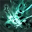

Solo Mode at item level 1640 with no Ark Grid cores. Dread Roar is the default spec: [tierlist.md](tierlist.md) rates it A / A- / B (avg 5.7) against Hellfire Successor's B / A / A (6.0), and on loagg the two are effectively tied (796 vs 785 players).
Codes are KR builds imported to CE; whether they play like KR depends on global having KR's 2026-04-22 balance patch. No Guardian Knight code made for Solo Mode or for no Ark Grid has been posted since that patch, so both codes here are party builds.

## Play this now

Dread Roar "333 instant-cast" build. 333 is the KR nickname for running three Order cores of the same type, so it's built for the Ark Grid. One reply on the Inven board ([post 7553](https://www.inven.co.kr/board/lostark/6469/7553), 2026-10-07) says that with no cores you should use the 333 tree.

```
D6511A1A6C34E9CD843EB0E3209A03D8A86E1096886B6E158DCCF3B447A9C20E753075E21A3224CDA1356B508667AC95D31D4A903CC0641A4D1F113C2E172DD9
```

- Source: Inven Guardian Knight board, "333 instant-cast" guide — https://www.inven.co.kr/board/lostark/6469/498 (first posted 2025-12-11, before the Ark Grid existed; the author marks it current as of 2026-07-18)
- Last change (6/29):  Guillotine Spin now uses the Vision rune, and the  Piercing Shock tripods and an awakening-skill node changed
- Ignore the cycle note about timing  Soaring Strike with the Moon core's 6% damage buff: that buff comes from an Ark Grid core, which you don't have
- The author says a different crit/Swiftness split needs a different tree; keep Swiftness high

## How it plays

- Damage centres on  Guillotine Spin (Vision rune), with short-cast  Piercing Shock filling in.
- **Head attack** build.
- Built around instant-cast skills and maximum Swiftness, so it depends on that Evolution split staying intact.
- Solo Mode gives you no support buffs, so cycles that assume a support's attack-speed buff run a bit slower.

## Setup

- **Engravings:** Grudge, Keen Blunt Weapon, Raid Captain, Adrenaline, Master Brawler
- **Stats and Ark Passive:** maximum Swiftness with the Sonic Breakthrough Evolution node (KR 음속 돌파)

Hellfire Successor's engravings, stats and Ark Passive come from its own guide (linked below).

## Rotation

The Dread Roar post's cycle is built around  Soaring Strike timed with the Moon core buff, so with no grid you play the same skills without that timing. The Hellfire Successor build below is the one whose author says to mix normal skills into the damage cycle when you have no grid.

## Other builds

### Runner-up — Hellfire Successor "New 3/5 Quake"

```
024E6FD0F7410B5EE222A44E9270BB2F1BED33F83019BBE2181602E4ACB99D93845AE494A74552EEDBE58B2781CBFFBBD98E29CBD93B47D92232F6E7C5ACEE71
```

- Source: Inven Guardian Knight board, the pinned certified guide — https://www.inven.co.kr/board/lostark/6469/280 (code updated 2026-06-18)
- Difference from the pick: built around  Quake Smash. It's the only candidate whose author says outright that it works both before and after the Ark Grid. With no grid, mix normal skills into the damage cycle and aim for crit rate as close to 100% as you can
- Known import bug: the code can import runes or skill levels wrong.  Piercing Shock's first tripod often lands on option 1 instead of option 2. Check the tree against the guide's slides after importing

## Caveats

- Both codes predate any post written for Solo Mode or no-grid play; the 333 tree on no cores rests on the single Inven reply above.
- Both codes are KR and untested on global; they're only safe if global already has KR's 2026-04-22 balance patch, which is unconfirmed.
