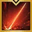
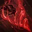
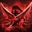
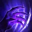

Solo Mode at item level 1640 with no Ark Grid cores. Demonic Impulse rates B / A+ / C (avg 4.7) in [tierlist.md](tierlist.md). Both builds were posted after KR's 2026-02-11 Demonic Impulse rework, and neither is a Solo Mode build: no KR Solo Mode code exists for this spec, so solo notes below are marked [inference].
Codes are KR builds imported to CE; global has the same rework (the "Ends of the Abyss" patch), but no one has confirmed these codes import correctly there.

## Play this now

Main pre-grid build. The author labels it "112 (= before Ark Grid)": 112 is the KR nickname for the Order Sun 1 / Moon 1 / Star 2 core set, which plays the same code and rotation as pre-grid.

```
AB885FC616808B7131C4948B5FF4C472DCDB707B9FE942A51530EB5B8481D4BFA19E0D0E63AF8D0D0F90B277F6B472B62483147E9B211709B09A4F5CE5085676
```

- Source: Hiloa, Inven Shadowhunter board — https://www.inven.co.kr/board/lostark/5498/71109 (2026-02-14, updated 2026-07-29)
- What the code holds: Enlightenment Demonic Impulse 1, Instinct Enhancement 3, Chaos Enhancement 3, Execution 3, Corrosion 2; Leap Unleashed Power 5, Release Potential 5, Demon's Ascension 3; hyper awakening  Blood Marsh; awakening  Fallen Ruin. Skill levels, tripods and runes are in the table under Setup
- KR nicknames used in the Ark Passive notes: **입타** = Standing Striker Evolution build, **뭉가** = Blunt Thorn Evolution build; **충모닉** is the whole Demonic Impulse Shadowhunter

## How it plays

- **Transform play:**  Demon Vision is always part of the transform;  Demon's Grip is the default partner (transforms from range). While transformed you're immune to flinch, and immune to hits and status ailments while transforming and un-transforming.
- Transforming heals about 20% HP, and the demon gauge doesn't drain on its own while transformed.
-  Blood Vortex +  Bloody Piercing unlock  Blood Demonic Clone (X). X halves the demon gauge and halves the cooldowns of Blood Vortex and Bloody Piercing; Blood Vortex and Bloody Piercing are the main nukes.
- **Any angle:** no positional requirement.
- Base crit rate is about 99% (Crit stat 23 + Demonize 30 + Adrenaline 20 + Chaos Enhancement 24 + accessories 2), so the main difficulty is the Evolution crit threshold below.

## Setup

- **Engravings:** Grudge, Keen Blunt Weapon, Adrenaline, Raid Captain, Cursed Doll. Cursed Doll swaps: **Hit Master** (doesn't boost awakening, bleed or poison damage; slightly weaker but usable), **Stabilized Status** (cheap Relic books; not bad, since Demonic Impulse keeps healing). The author doesn't recommend **Mass Increase** because the attack-speed loss feels bad
- **Stats and Ark Passive:** Evolution table below; Enlightenment and Leap as listed under the code. Use Standing Striker by default and switch to Blunt Thorn once crit goes over 100%. With a Relic Adrenaline book use Standing Striker; with an Epic Adrenaline book and crit over the cap, either move 1–2 Evolution points from Crit to Swiftness on Standing Striker or use Blunt Thorn. On Blunt Thorn with a crit synergy in the party, trade Keen Sense 2 for Optimized Training 1 + Limit Break 1. Solo Mode has no party crit synergy [inference], so the no-synergy numbers apply
- **Gems (6 damage, 5 cooldown):** damage gems on  Blood Vortex,  Bloody Piercing,  Blood Massacre,  Leaping Blow,  Gore Bleeding and  Blood Demonic Clone, priority Blood Vortex >> Blood Demonic Clone >> Bloody Piercing > Gore Bleeding > Blood Massacre > Leaping Blow (highest gems on Blood Vortex and Blood Demonic Clone); cooldown gems on Blood Vortex, Bloody Piercing, Blood Massacre, Leaping Blow and Gore Bleeding, priority Blood Vortex = Bloody Piercing >>> Blood Massacre > Leaping Blow > Gore Bleeding (highest gems on Blood Vortex and Bloody Piercing)

Shared by every code below unless a build says otherwise.

**Evolution** (the main code's author defaults to Standing Striker):

| Tier | Standing Striker build (입타) | Blunt Thorn build (뭉가) |
|---|---|---|
| T1 | Crit 10, Specialization 30 | Crit 10, Specialization 30 |
| T2 | Limit Break 1, Optimized Training 2 | Keen Sense 2, Optimized Training 1 |
| T3 | Zealous Smite 2 | Zealous Smite 2 |
| T4 | Critical 1, Pulverize 1 | Critical 1, Master 1 |
| T5 | Standing Striker 2 | Blunt Thorn 2 |

**Skills, tripods, runes (main code).** Tripod digits are the guide's slot numbers (tier 1 / 2 / 3).

| Skill | Lv | Tripods | Rune | Note |
|---|---|---|---|---|
|  Demonic Slash | 10 | 132: Damage Amplification / Nimble Movement / Ambush Charge | | Gap closer, synergy (8 s). Swap: 131 (Chain Charge): can't pass through the boss, but you use it twice |
|  Spinning Dive | 10 | 212: Excellent Mobility / Tenacity / Spinning Master | | Hit immunity |
|  Rising Claw | 10 | 232: Brutal Honesty / Concussion / Grasp of Death | | Counter |
|  Demonic Clone | 10 | 331: Tenacity / Fist of Destruction / Enh. Release Shadowburst | | Hit immunity; optional transform skill |
|  Demon Vision | 14 | 131: Quick Release / Encroaching Power / Instant Discharge | Legendary Wealth | Transform skill (always used) |
|  Decimate | 14 | 211: Swift Fingers / Encroachment Discharge / Cruel Hand | | Filler normal skill |
|  Demon's Grip | 14 | 322: Swift Fingers / Encroaching Power / Stretching Hand | | Main transform skill (ranged) |
|  Howl | 14 | 322: Damage Amplification / Encroaching Power / Mighty Roar | | Synergy (16 s); optional transform skill. Swaps: 122 (faster), 121 (faster still, smaller area) |
|  Ruining Rush (Q) | | | | Synergy (6 s) |
|  Death Claw (W) | | | Epic Quick Recharge | Counter |
|  Destruction (E) | | | Legendary Rage | Synergy (16 s) |
|  Gore Bleeding (R) | | | Legendary Quick Recharge | |
|  Leaping Blow (A) | | | Epic Galewind | Hit immunity |
|  Blood Massacre (S) | | | Legendary Vision | |
|  Blood Vortex (D) | | | Legendary Galewind | Main nuke, charges X |
|  Bloody Piercing (F) | | | Legendary Galewind | Main nuke, charges X |
|  Blood Demonic Clone (X) | | | | X finisher; hit immunity |
|  Blood Marsh (T) | | | | Hyper awakening; hit immunity (from the Leap node Demon's Ascension) |
|  Fallen Ruin (V) | | | | Awakening; hit and status immunity |

Keep Galewind (or Vision) fixed on A/S/D/F. The Q/W/E/R runes are up to you: 4× Quick Recharge, Conviction, or Bleed/Poison.

## Rotation

**Opener (with an Adrenaline / Atropine potion):**

1. Close the gap with  Demonic Slash.
2. Transform with  Demon's Grip +  Demon Vision.
3. Use  Death Claw to reach 5 Adrenaline stacks.
4. Press  Blood Vortex and drink the Atropine potion at the same moment.
5. Then:  →  →  →  →  →  →  →  →  → . The Atropine buff ends here.
6. Continue with step 3 of the loop.

**Loop:**

1. Transform:  Demon's Grip →  Demon Vision. Grip first, because Grip fills the identity gauge when it reaches the boss; the other order delays the transform.
2.  Blood Vortex →  Bloody Piercing →  Blood Demonic Clone.
3. Until Blood Vortex / Bloody Piercing come back, use:  Blood Marsh,  Blood Massacre,  Gore Bleeding,  Leaping Blow,  Destruction,  Death Claw,  Ruining Rush.
4.  Blood Vortex →  Bloody Piercing →  Blood Demonic Clone. You un-transform automatically.
5. Repeat.

**Best opener (if you can wait 45 s before the fight starts):**

1. At the start, drink an awakening potion, then use Blood Vortex and Bloody Piercing. X stays ready even after you un-transform.
2. Wait about 45 s.
3. Close the gap with  Demonic Slash, transform, then use  Destruction,  Death Claw and  Ruining Rush to reach 5 Adrenaline stacks.
4. Press  X and drink Atropine at the same moment.
5. Then X → Blood Vortex → Bloody Piercing → Blood Marsh → X.
6. Re-transform with Demon's Grip + Demon Vision.
7. Blood Massacre → Fallen Ruin → Leaping Blow → Gore Bleeding → Destruction.
8. Continue with step 3 of the loop.

**Transform options** (all start with  Demon Vision):

- \+  Demon's Grip: the default; transforms from range.
- \+  Howl: when you need the synergy.
- \+  Demonic Clone: when you need flinch or hit immunity.

**Solo Mode notes [inference]:**

- With no party, synergy timing doesn't matter.  Howl,  Destruction and  Demonic Slash still debuff the boss for your own damage, so keep using them.
- No support means no buff to wait for in the opener; the 45-second opener only applies where the raid has a waiting area before the boss.
- The heal on transform and the hit immunity on transform / un-transform make up for not having support shields.

## Other builds

### Runner-up — "No Ark Grid" alt build

```
CF1AAE309D1206DD8AB176921536E4A3223859E9E6270FE94CF03FC0F475E74CA50A3313EA21FD7173137CCC7DAA2306FE3B146B5F5DBCADF81B733B8E43F94C
```

- Source: 멍멍대포, Inven Shadowhunter board — https://www.inven.co.kr/board/lostark/5498/70915 (2026-02-12). Tested on a 1690 alt (combat power 1590) in three Skolakia clears; no other raid tested yet. The author calls it the easiest and most comfortable build before Ark Grid
- Difference from the pick: transform is  Demon's Grip →  Howl instead of Grip + Demon Vision; the code uses Bleed runes (the author runs Poison; either works)
- Rotation:
  1.  Destruction (synergy plus bleed or poison).
  2. Hyper Awakening skill.
  3.  Blood Vortex →  Bloody Piercing →  X →  Blood Massacre →  Leaping Blow →  Death Claw (Quick Recharge) →  Gore Bleeding.
  4. Use whatever comes off cooldown, finish with Blood Vortex → Bloody Piercing → X, and repeat.
  - The Hyper Awakening skill can wait until after Blood Vortex / Bloody Piercing / X.
  - If you don't have full movement speed when you transform, use  Demonic Slash first, and Destruction can go after the Hyper Awakening skill and D/F/X.
- Damage gems on R, A, S, D, F, X (priority D > X > F > S > A); cooldown gems on W, A, S, D, F (priority D/F > S > A > W)

## Caveats

- Neither build was written for Solo Mode; the solo notes are inferences, not author advice.
- Both are KR codes: global has the same Demonic Impulse rework, but nobody has confirmed they import correctly there.

## Paradise Crucible

Crucible (KR 낙원 증명) is Paradise's solo boss ladder, ranked per class. Only skill levels and tripods carry into Paradise, so your raid spec and Ark Grid don't matter here (details in [paladin.md](paladin.md#paradise-crucible)).
These KR codes were checked on [lostark.bible](https://lostark.bible/tools/skill-code) and uploaded to CE on 2026-10-15, so they import on EUC. Whether they play the same on global depends on global having KR's balance patches, which is unverified.

### Pick

```
CF9117076DCB3A978FCBCAB2086EE76ADB93393A5BD9A35EB667B9ECA42D8A00F42C0934510702D296EC1FA220D65F64D12CD146B9620CF20EA445A5A90F7246
```

- Source: [KR Season 4 page](https://sites.google.com/view/achi-loa/%EB%82%99%EC%9B%90/%EB%82%99%EC%9B%90-%EC%8B%9C%EC%A6%8C4), weeks 2–6 (2026-09-16 → 2026-10-14); Crucible stage 4–7, played around demon form. Week 6: stage 7 at about 2.1M Paradise score
- Awakening  Fallen Ruin; hyper awakening  Blood Marsh. No runes (they wouldn't apply anyway)

| Skill | Level | Tripods |
|---|---|---|
|  Demon's Grip | 14 | Swift Fingers, Encroaching Power, Stretching Hand |
|  Rising Claw | 1 | — |
|  Piercing Thorn | 14 | Bleed Effect, Rotting Zone, Advancing Thorns |
|  Demon Vision | 14 | Quick Release, Encroaching Power, Instant Discharge |
|  Grind Chain | 14 | Critical Blow, Chain Attack, Encroachment Release |
|  Howl | 14 | Damage Amplification, Encroaching Power, Mighty Roar |
|  Cruel Cutter | 14 | Bleed Effect, Double-Edged Stike, Encroachment Release |
|  Thrust Impact | 10 | Swift Thrust, Deep Thrust, Encroachment Release |

### Runner-up

```
5F4573A10FFFE025CBB554C466BF9581384388B0546A780A7F3201DCEE3D6F17DD7107B89F81A265D4258AAE5DF7C575BD7030B813CAB9785012D870FF40EBC8
```

- Source: [KR Season 3 page](https://sites.google.com/view/achi-loa/%EB%82%99%EC%9B%90/%EB%82%99%EC%9B%90-%EC%8B%9C%EC%A6%8C3), weeks 6–15 of Season 3 (2026-06-24 → 2026-08-26)
- Same awakening and hyper awakening as the pick. Differences:

| Skill | Pick | Runner-up |
|---|---|---|
|  Demon Vision | Lv14: Quick Release, Encroaching Power, Instant Discharge | Lv10: Quick Release, Encroaching Power, Instant Discharge |
|  Piercing Thorn | Lv14: Bleed Effect, Rotting Zone, Advancing Thorns | Lv14: Vital Point Hit, Encroachment Discharge, Advancing Thorns |
|  Thrust Impact | Lv10: Swift Thrust, Deep Thrust, Encroachment Release | Lv14: Swift Thrust, Deep Thrust, Encroachment Release |

### Restoration order

The author's order for a class that uses its identity gauge (slot effects in [paladin.md](paladin.md#paradise-crucible)). Week 1 he cleared stages 1–3 with a Perfect Suppression-style code (no transform); from week 2 he plays the pick. Whistle 6 fills the identity gauge much faster, and he names Shadowhunter as a class that benefits.

- **Phase 1 (levels 1–4, week 1):** Mask 1 → Censer 1 → Liquor Glass / Bell / Mirror 2 → Mask / Censer / Whistle 2 → Whistle 3 → Liquor Glass 3 → Whistle 4 → Bell / Mirror 3 → Censer 4 → the rest to 4
- **Phase 2 (level 6):** Censer 6 → Liquor Glass 6 → Whistle 6 → Mask 6, then Bell / Mirror
- **Phase 3 (level 9):** Liquor Glass 9 first (hyper awakening cooldown), then Censer 9, then the rest

Season 3 notes: open with the movement skill (synergy) + skills, then awakening + hyper awakening + skills once the boss's damage reduction is low. Another player's ["transform at stage 15"](https://www.inven.co.kr/board/lostark/5498/72613) post (2026-08-14) reached top 30 by transforming at stage 15.
