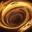
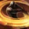
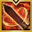

# Berserker's Technique Berserker — Solo Mode gold-funnel alt

Collected 2026-10-21. Codes are KR builds imported to CE (EUC) and checked on lostark.bible; whether they play like KR depends on global having KR's Berserker patches (unverified).

Why Technique: the three Inven tier lists in [`tierlist.md`](tierlist.md) (Oct 20, Oct 18, Ext. Mordum Oct 6) rate Berserker's Technique A / A / A (Avg 7.0) against Mayhem B / A (Avg 5.5).

## Brief

- Class / spec: Berserker, Berserker's Technique (광전사의 비기)
- Content: Solo Mode raids; gold-funnel alt, easy over max damage
- Item level 1648, Ark Grid not unlocked (opens at 1700). Plan: 1660 → 1670 → 1680 → 1710. Use **Now (pre-grid)** until 1700, then switch to **At 1700+**
- Angle dependence: **none**. Every build below runs Grudge, Keen Blunt Weapon, Raid Captain, Cursed Doll, Mass Increase with no Ambush Master

## Skill legend

| Icon | Global name | KR name | Role |
|---|---|---|---|
|  | Bloody Rush | 블러디 러쉬 | Identity skill (KR "러쉬"); first gem priority |
|  | Overdrive | 오버드라이브 | First skill after entering Burst (Z) in the pre-grid rotation |
|  | Power Break | 파워 브레이크 | Main damage skill in the 111 build |
|  | Tempest Slash | 템페스트 슬래쉬 | Second in the pre-grid Burst order |
|  | Whirlwind | 휠윈드 | Third in the pre-grid Burst order; opens the non-Burst order in the 111 build |
|  | Red Dust | 레드 더스트 | Fourth in the pre-grid Burst order; Atk. Power self-buff |
|  | Finish Strike | 피니쉬 스트라이크 | Centrepiece of the Finish build (both pre-grid codes) |
|  | Assault Blade | 어설트 블레이드 | Slot of the alternative Assault build |
|  | Hell Blade | 헬 블레이드 | Damage skill |
|  | Mountain Crash | 마운틴 크래쉬 | Damage skill; recovery in the 111 build |
|  | Shoulder Charge | 숄더 차지 | Gap closer; the 111 guide is named after it ("숄차") |
|  | Blood Slash | 블러드 슬래시 | Hyper Awakening skill (pre-grid codes) |
|  | Fury Method | 퓨리 메소드 | Hyper Awakening skill (1700+ codes) |
|  | Berserk Fury | 버서크 퓨리 | Awakening skill |
|  | Chain of Vengeance | 체인 오브 벤전스 | Awakening skill (the 1700+ pick) |

KR terms: **원예저돌질** is the KR initial-string of the engraving set (원한 = Grudge, 예리한 둔기 = Keen Blunt Weapon, 저주받은 인형 = Cursed Doll, 돌격대장 = Raid Captain, 질량 증가 = Mass Increase). **뭉가** (Blunt Thorn), **음돌** (Supersonic Breakthrough) and **입타** (Standing Striker) are Evolution-node nicknames. **겁화** = damage gem. **루현** is the guide author's handle. **111** is the Ark Grid core set (Sun1 Combination 콤비네이션 / Moon1 Blood Circulation 피의 순환 / Star1 Crushing Storm 분쇄 폭풍).

## Now (pre-grid, 1648 → below 1700)

### Pick — Finish build, Standing Striker (입타)

```
8EF9DB4FF07C2FFBFFF0B8EF0637700B73D17EF9BC81D2A5188CB4BA28D24E2E423B6733985906E82A5A6B219DBA295D21EDE6EA2057A1D2D3D193E834EE331A
```

- Source: 하누, "(12.10) 아크 그리드 이전 비기 피니쉬 빌드 가이드" — https://www.inven.co.kr/board/lostark/5341/139702 (posted 2024-08-11, body updated to at least 2025-07-25)
- Code: Technique (Enlightenment Brawn 3, Invigoration 3, Burst Enhancement 3, Berserker Technique 3, Stampede 2); Evolution Specialization 30, Crit 10, Limit Break 3, Strike 2, Critical 1, Pulverize 1, Standing Striker 2; Leap Instant Spell 2, Release Potential 4, Unleashed Power 5, Fury Cycle 3; hyper awakening  Blood Slash; runes on all 8 leveled skills
- Engravings: Grudge, Raid Captain, Keen Blunt Weapon, Cursed Doll, Mass Increase (no Ambush Master); Critical elixir; Crit + Specialization bracelet
- Ark Passive: fixed Specialization 30, Crit 10, Strike 2; the Standing Striker slot is the author's fallback when you lack crit synergy or a speed bracelet. Stampede 2; the author does not recommend Fury Consumption pre-grid
- Needs minimum ~1784 Specialization; below that put the  Tempest Slash tripod on Storm Slash
- Tripods:  Finish Strike Enhanced Strike or Gravitational Blow;  Hell Blade Bloody Eruption
- Priority right after entering Burst (Z):  Overdrive →  Tempest Slash →  Whirlwind →  Red Dust

### Runner-up — Finish build, Supersonic Breakthrough (음돌)

```
6299E0EFA0E393D419F0B6AA985AB93EB47B44704D0B2078DAED4C7FBD8B620EB02B41C866E8F8CD143FF141E6D0501CEE5693C0CE3E1E2C91BEB60CFF0849E9
```

- Source: 루현, "▶비기 | 1700이전 가이드 | 25.6.25 밸패 반영" — https://www.inven.co.kr/board/lostark/5341/149897 (2025-07-21)
- Difference: Evolution Specialization 30, Crit 8, Swiftness 2, Supersonic Breakthrough 2 instead of Standing Striker 2 and Crit 10. Only works if you have an attack/move-speed bracelet; hyper awakening  Blood Slash; awakening  Berserk Fury. The author's note: take Blunt Thorn instead if you can reach ~119% crit
- Author setup: Stampede is required;  Bloody Rush damage gems (겁화) come first

Both pre-grid codes are 2025 Finish builds (before KR's 2026-02-11 Berserker change); Technique is the harder rotation before cores. Check the tripods in the skill window after importing.

## At 1700+ — 111 Shoulder Charge Technique (Sun1 Combination / Moon1 Blood Circulation / Star1 Crushing Storm)

Most common core set on loagg (Technique, 1720+, 226 characters).

### Pick

```
17D5F9183985DCAD5000F860ACD1F3A172D15B1D78792B0C56409B4F94FB708136B8B4FD556A5D6BF3512AB17E79EC09EB807BC4D0072E3C4F6F6C52164D6CAC
```

- Source: 루현, "▶비기 가이드 | 111숄차비기 & 212비기" — https://www.inven.co.kr/board/lostark/5341/148990 (pinned, body updated 2026-07-27); same code in https://www.inven.co.kr/board/lostark/5341/152431 (2025-12-15). Correction post: https://www.inven.co.kr/board/lostark/5341/154559 (2026-07-27)
- Code: Technique (Enlightenment Brawn 3, Invigoration 3, Burst Enhancement 3, Berserker Technique 3, Fury Consumption 1, Stampede 1); Evolution Specialization 30, Crit 8, Swiftness 2, Limit Break 3, Strike 2, Critical 1, Pulverize 1, Supersonic Breakthrough 2; Leap Instant Spell 2, Release Potential 4, Unleashed Power 5, Fury Amplification 3; hyper awakening  Fury Method; awakening  Chain of Vengeance; runes on all 8 leveled skills
- Engravings: Grudge, Raid Captain, Keen Blunt Weapon, Cursed Doll, Mass Increase (no Ambush Master, no Adrenaline); Critical elixir; Crit + Specialization bracelet
- Ark Passive: Critical and Pulverize fixed. Blunt Thorn if you reach ~119% crit, otherwise Supersonic Breakthrough (the code's choice). The 2026-07-27 correction recommends the Master node and an Evolution of Crit 10, Specialization 30, Keen Sense 2, Limit Break 1, Strike 2, Critical 1, Master 1, Blunt Thorn 2 (adjust Keen Sense / Limit Break to the bracelet) — set it in-game after importing. Fury Consumption is now the default (Burst cycles got shorter); go back to Stampede if the third  Bloody Rush starts missing
- Skills:  Shoulder Charge with the Excellent Mobility tripod;  Red Dust with a Galewind rune; try the Wealth rune if recovery keeps missing;  Power Break with Galewind or Quick Recharge is the higher-ceiling option;  Finish Strike Tenacity tripod; damage gems (겁화) on  Bloody Rush and  Power Break
- Cycle: 2 Z per Burst play; inside Burst a strict Overdrive → Power Break → Tempest Slash order,  Power Break is the main skill. Outside Burst,  Shoulder Charge to close distance, then  Whirlwind; the corrected non-Burst order is Whirlwind → Mountain Crash → Power Break → Tempest Slash → Red Dust → Overdrive. Open Burst with Bloody Rush → Overdrive → Power Break → Tempest Slash → Bloody Rush, not with  Fury Method
- Do not swap  Hell Blade in for Shoulder Charge or Finish Strike (the author advises against both)

### Runner-up — Power Break Galewind variant

```
AB6563EFE831C5A1B646F4FCC076954E4CFC70C591250112269D4D321DD9A8D29DEE7E51D47176EE3F5B8010A8F8EFFA06F2EBBF9BB285327C258A26356D626B
```

- Source: same guide, https://www.inven.co.kr/board/lostark/5341/152431 (2025-12-15)
- Difference: Stampede 2 instead of Fury Consumption 1 + Stampede 1; awakening  Berserk Fury; the author labels it the  Power Break Galewind variant (the higher-ceiling option)

# Berserker in the Paradise Crucible

Crucible (KR 낙원 증명) is Paradise's solo boss ladder, ranked per class. Only **skill levels and tripods** carry into Paradise: engravings, gems, runes, cards and the whole Ark Passive don't apply (official release notes; details in `paladin.md` → What applies in Paradise). So your raid spec and Ark Grid don't matter here; only the skill bar, levels, tripods and awakening choice do.

These are KR codes, checked on [lostark.bible](https://lostark.bible/tools/skill-code) and uploaded to CE on 2026-10-15, so they import on EUC.

## Crucible skill legend

| Icon | Global name | KR name |
|---|---|---|
|  | Berserk Fury | 버서크 퓨리 |
|  | Blood Slash | 블러드 슬래시 |
|  | Finish Strike | 피니쉬 스트라이크 |
|  | Fury Method | 퓨리 메소드 |
|  | Hell Blade | 헬 블레이드 |
|  | Mountain Crash | 마운틴 크래쉬 |
|  | Overdrive | 오버드라이브 |
|  | Power Break | 파워 브레이크 |
|  | Red Dust | 레드 더스트 |
|  | Shoulder Charge | 숄더 차지 |
|  | Sword Storm | 소드 스톰 |
|  | Tempest Slash | 템페스트 슬래쉬 |

## Recommended Crucible code

```
F91DD82AE3D362B473345402DF99F2D7B18D0660C28A0F4CA938EEF947CA7178BD75F083AAA3A6A7564D7E9D9DD738D9EBEB90817DC246B6B06F28F3EDD96E8E
```

- Source: [KR Season 4 page](https://sites.google.com/view/achi-loa/%EB%82%99%EC%9B%90/%EB%82%99%EC%9B%90-%EC%8B%9C%EC%A6%8C4): listed weeks 4–6 (2026-09-30 → 2026-10-14), Crucible stage 7–8. It replaced his week 2–3 code.
- Awakening  Berserk Fury; hyper awakening  Fury Method. No runes (they wouldn't apply anyway).

| Skill | Level | Tripods |
|---|---|---|
|  Power Break | 10 | Swift Fingers, Ranged Hit, Whirlpool |
|  Shoulder Charge | 3 | — |
|  Hell Blade | 14 | Leap, Burst Enhancement, Bloody Eruption |
|  Red Dust | 14 | Damage Amplification, Enhanced Strike, Red Wave |
|  Tempest Slash | 14 | Nimble Movement, Burst Enhancement, Storm Slash |
|  Mountain Crash | 14 | Quick Prep, Technique Charge, Earthquake Shock |
|  Finish Strike | 14 | Enhanced Strike, Weak Point Detection, Lights Out |
|  Overdrive | 14 | Swift Fingers, Burst Enhancement, Gale Cutter |

## Runner-up

```
FC6731F8391B53BAF158E4D7D51EEEE361BD2C080D815150BED88B84FED7A66B8AC4A31E2B9C5169F2D324EAF71B5484C1EECF8CF017B8C4CEAE932E5345DF97
```

- Source: [KR Season 3 page](https://sites.google.com/view/achi-loa/%EB%82%99%EC%9B%90/%EB%82%99%EC%9B%90-%EC%8B%9C%EC%A6%8C3): weeks 5–15 of Season 3 (2026-06-17 → 2026-08-26), stages 7–15 with all slots at 9.
- Awakening  Berserk Fury; hyper awakening  Blood Slash.
- Differences from the recommended code:

  | Skill | Recommended | Runner-up |
  |---|---|---|
  |  Mountain Crash | Lv14: Quick Prep, Technique Charge, Earthquake Shock | Lv10: Damage Amplification, Technique Charge, Earthquake Shock |
  |  Power Break | Lv10: Swift Fingers, Ranged Hit, Whirlpool | Lv14: Swift Fingers, Ranged Hit, Whirlpool |
  |  Red Dust | Lv14: Damage Amplification, Enhanced Strike, Red Wave | Lv14: Nimble Movement, Enhanced Strike, Red Wave |
  |  Shoulder Charge | Lv3: no tripods | Lv1: no tripods |
  |  Sword Storm | not used | Lv14: Quick Prep, Weak Point Detection, Earthquake Wave |
  |  Tempest Slash | Lv14: Nimble Movement, Burst Enhancement, Storm Slash | not used |

## Notes and Restoration order

- Week 6: Crucible stage 8 at about 3M Paradise score. Weeks 4–5 he was stuck at stage 7 because he couldn't get a slot to level 9.

Restoration order (the author's, for a class that uses its identity gauge; each number is the slot's Restoration level, and slot effects are in `paladin.md` → Restoration priority):

- **Phase 1 (levels 1–4, week 1):** Mask 1 → Censer 1 → Liquor Glass / Bell / Mirror 2 → Mask / Censer / Whistle 2 → Whistle 3 → Liquor Glass 3 → Whistle 4 → Bell / Mirror 3 → Censer 4 → the rest to 4.
- **Phase 2 (level 6):** Censer 6 → Liquor Glass 6 → Whistle 6 → Mask 6, then Bell / Mirror.
- **Phase 3 (level 9):** Liquor Glass 9 first (hyper awakening cooldown), then Censer 9, then the rest.
