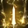
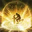

# Support Paladin (Blessed Aura) — skill codes and guide

Skill, tripod, rune, engraving, Ark Grid core and Ark Passive names are global client names. Skills, tripods, runes and Ark Grid cores are matched to the KR names by game ID through lostarkcodex.com (US vs KR locale); Ark Passive nodes come from the Lost Ark Wiki (Paladin/Ark_Passive). Icons in `assets/icons/holyknight/` were downloaded from lostarkcodex.com and converted to 32px PNG.

## Skill legend

| Icon | Global name | KR name | Role |
|---|---|---|---|
|  | Light Shock | 빛의 충격 | Brand skill option (8s cooldown) |
|  | Sword of Justice | 정의의 검 | Brand skill option (15s cooldown) |
|  | Holy Explosion | 신성 폭발 | Brand skill option (24s cooldown) |
|  | Light of Judgment | 심판의 빛 | Main Piety builder |
|  | Executioner's Sword | 집행자의 검 | Fast counter, destruction, stagger |
|  | Holy Sword | 신성검 | Long-range counter; 2 charges with Sword's Prayer |
|  | Holy Protection | 신성한 보호 | Shield plus small heal |
|  | God's Decree | 신의 율법 | Shield plus emergency save, push immunity |
|  | Wrath of God | 신의 분노 | Attack buff, push immunity |
|  | Heavenly Blessings | 천상의 축복 | Attack buff (damage reduction, mana regen, attack speed) |
|  | Divine Justice | 신성한 정의 | Hyper awakening skill (T) of the support spec |
|  | Holy Aura | 신성의 오라 | Support identity skill (X) |
|  | Divine Wave | 신성 파도 | Support identity skill (Z); refills Piety, small shield |
|  | Sacred Executioner | 신의 집행자 | Judgment identity skill (Z) |
|  | Judgment Blade | 심판의 칼날 | Judgment identity skill (X), usable only in Sacred Executioner |
|  | Flash Slash | 섬광 베기 | Main Judgment damage skill |
|  | Flash Thrust | 섬광 찌르기 | Quick Recharge skill |
|  | Spin Slash | 회전 베기 | Quick Recharge skill |
|  | Dash Slash | 질주 베기 | Movement skill, Rare Quick Recharge rune |
|  | Charge | 돌진 | Rare Quick Recharge rune; its thrust is the counter in Solo Mode |
|  | Execution of Justice | 정의 집행 | Damage-immunity skill |
|  | Punishment | 처단 | Stagger and damage skill |
|  | Execution of Judgment | 판결 집행 | Hyper awakening skill of the Judgment spec |
|  | Alithanes's Light | 알리사노스의 빛 | Awakening skill, set in the Crucible codes |

Icons and KR names of Holy Aura and Sacred Executioner: Sacred Executioner is ID-matched (lostarkcodex skill 36001, "신의 집행자 기본 공격" / "Sacred Executioner Basic Attack"), and its icon is the Lost Ark Wiki skill icon. Holy Aura has no lostarkcodex skill entry; its KR name comes from Namuwiki's Paladin skill page and its icon from the Lost Ark Wiki.

## Other terms

| Global name | KR name | Match |
|---|---|---|
| Paladin | 홀리나이트 (홀나) | KR-NAMES.md |
| Blessed Aura (support spec) | 축복의 오라 | KR-NAMES.md |
| Judgment (DPS spec) | 심판자 | KR-NAMES.md |
| Solo Mode | 싱글모드 | |
| Piety Meter ("faith" in the KR sources) | 신앙 게이지 | Lost Ark Wiki; KR from Namuwiki |
| Destiny | 운명 | Global name as stated in the earlier notes for this guide; not ID-verified |
| Doom / Blaze (gems) | 겁화 / 작열 | |
| Divine Liberation (Tier 4 main node) | 신성 해방 | Inferred from the effect text (Divine Wave refills 10% Piety, works during Holy Aura) |
| Light's Vestige (Tier 4 side node) | 빛의 흔적 | Same KR name as the Light's Vestige tripod |
| Bold Salvation (Tier 3 side node) | 빠른 구원 | Inferred from the effect text (Divine Wave cooldown −0.25s) |
| Righteous Light (Leap node) | 정의의 빛 | Same KR name as the Light of Judgment tripod Righteous Light; effect (Piety refill after Divine Justice) matches |
| Sacred Light (Leap node) | 성스러운 빛 | Inferred from the effect text (shield on Divine Justice) |
| Prelude of Punishment (side node) | 징벌의 서막 | Inferred from the effect text (+5% attack speed) |
| Protective Judgement (side node) | 심판의 가호 | Inferred from the effect text (20% max HP shield on Judgment Blade use) |
| Keen Sense / Limit Break (Evolution nodes) | 예리한 감각 / 한계 돌파 | Maxroll Ark Passive overview |
| Drops of Ether (engraving) | 구슬동자 | Inferred from the effect (Strength / Flash / Wind / Defense / MP orbs) |
| Vital Point Hit (engraving) | 급소 타격 | Inferred from the effect (stagger +27%) |
| Magick Stream (engraving) | 마나의 흐름 | Inferred from the effect (10 stacks, cooldown reduction at max) |
| Expert, Awakening, Grudge, Raid Captain, Keen Blunt Weapon, Adrenaline, Cursed Doll, Mass Increase, Stabilized Status | 전문의, 각성, 원한, 돌격대장, 예리한 둔기, 아드레날린, 저주받은 인형, 질량 증가, 안정된 상태 | As written in the sources |

Names that stayed KR (no global equivalent): **홀라결**, the KR community nickname for the Paladin Judgment 111 core-set build; **진정한 지원가**, a Solo Mode buff whose global name I could not find (the source author translates it "True Supporter"). Author and channel names (유스타인, 라이츄꼬부기, 리연) are people and stay as written.

## Brief

| Field | Value |
|---|---|
| Class / spec | Paladin, Blessed Aura support |
| Content | Party raids |
| Ark Grid | 32 Order points, can go to 39 (+7) |
| Engravings / stats / preference | Not stated; guide defaults below |

The sources are Korean (Inven Paladin board). They have not been tested on global: a KR code imports correctly only if global has KR's balance patch.

## Recommended code: 2/6 tree

```
E0EDC6A738A56403818250FD3D8A28EDBF9E700B8AB332B3C3B73CA0496A13110D07BFEB08C34AA07CEA5B0F8CA4EEF3D55FEC19A157503516D6BE90519F0AAD
```

- Source: [certified support Paladin guide](https://www.inven.co.kr/board/lostark/5558/77760). Posted 2024-08-31, Ark Grid section updated 2026-03-08.
- Tree: 2 Punish (blue) + 6 Holy (yellow) skills. The author calls it the most common support tree.
- Built for: Order Star **Sword's Prayer** at 17P.
- Jev pick probability: 0.53 (vs 0.44 for the Holy Explosion code below).

## The other codes

| Code | Source | Date | Difference |
|---|---|---|---|
| 2/6 tree (recommended) | [guide](https://www.inven.co.kr/board/lostark/5558/77760) | 2026-03-08 | Standard tree; keeps the countering and stagger strength of 2 blue skills |
| Holy Explosion brand | [simple guide](https://www.inven.co.kr/board/lostark/5558/88684) | 2026-06-26 | 7 fixed skills +  Holy Explosion as the brand skill. Longer brand window, more relaxed. Same cores as every other code: Star Sword's Prayer; the author's Sun / Moon pick is True Justice / Divine Cause |
| Light Shock brand | [simple guide](https://www.inven.co.kr/board/lostark/5558/88684) | 2026-06-26 | 7 fixed skills +  Light Shock with Legendary Galewind rune. Higher ceiling (faster Z cooldown), but a sub-second brand window |
| 1/7 tree | [guide](https://www.inven.co.kr/board/lostark/5558/77760) | 2026-03-08 | 1 blue + 7 holy; protection and Holy Aura uptime focus. Author marks it **rarely used now** |

Holy Explosion brand:
```
A8255A801F1E3E4878D33563F296AEF0A6667DCD7868C0915906FE6CA4C2CD4642B6FC36A0653B8EB6D12CD857B3DE1F76F4D1DAD481AD8C7D23E2756385DDA7
```

Light Shock brand:
```
107306F1848CF99F68A7E924640FE1125F23974968ABFFD37F56C77AD0F24F1278B5BDE9EEF799D1F31DEDDE6FF1D0CE800066EFBB87E4718F5A42F165472135
```

1/7 tree (not recommended):
```
E7399A71B28E164DC16547D0BA4E56CFA00A4C7C38942B490910FC594E22D784DA8809937FA48E1F7BFDAAC0697D61A2118AE0DBA0E56A907E88F6D274844B27
```

### Brand skill choice

| Skill | Cooldown | Recommended tripods | Rune | Notes |
|---|---|---|---|---|
|  Light Shock | 8s | Swift Fingers → Light's Vestige (8s brand) | Legendary Galewind | Leave at **level 7**; levels 8–10 only raise mana cost. Has push immunity and almost no start-up. Brand lasts only 0.x s past the cooldown, so it drops easily |
|  Sword of Justice | 15s | Insight (−3.5s, +2m range) → Summon Holy Sword (10s brand) → Dazzling Light Sword (+3s) | Galewind / Quick Recharge / Judgment | Brand survives one missed cast. Long start-up. Best skill for popping the Judgment rune |
|  Holy Explosion | 24s | Swift Fingers → Light's Vestige (15s brand) → Prepared Explosion | Wealth / Quick Recharge / Overwhelm / Galewind | Push immunity, destruction, stagger and Piety gain in one skill (stagger 189, 8 hits). With Star **Prayer of Divine Surge** it gets 2 charges and refills Piety during Holy Aura |

## Ark Grid

### What the support cores do

Core names are global's, from [Maxroll's Ark Grid overview](https://maxroll.gg/lost-ark/resources/ark-grid-overview) (localization updated 2026-09-15). The KR names are matched by game ID on lostarkcodex.com (Maxroll's item IDs resolve there in both locales); they are listed in the core name table below.

The Star core changes how you play; Sun and Moon cores only add buff strength. The Sun core's 14P effect triggers on Destiny, and only a Moon core at 14P+ activates Destiny. **So the Moon core needs 14P for the Sun core's main effect to work.**

| Slot | Core | 10P | 14P | 17P |
|---|---|---|---|---|
| Sun 1 | Heavenly Agent | Ally Atk +1.3% | Destiny → +5% stagger dmg | Ally Atk +5.6/8.5% |
| Sun 2 | **True Justice** | Ally Atk +1.3% | Destiny → +7% shields/heals on party | Divine Justice (T skill) ally damage buff +27/40% |
| Sun 3 | Blessing of Light | Ally Atk +1.3% | Destiny → self −5% damage taken | Holy Aura ally damage buff +6.5/10% |
| Moon 1 | Heavenly Resolve | Ally dmg +1.5% | Heavenly Blessings triggers Destiny | Ally Atk +5.6/8.5% |
| Moon 2 | **Divine Cause** | Ally dmg +1.5% | Holy Protection triggers Destiny | Divine Justice ally damage buff +27/40% |
| Moon 3 | Divine War | Ally dmg +1.5% | Divine Wave (Z) triggers Destiny | Holy Aura ally damage buff +6.5/10% |
| Star 1 | **Sword's Prayer** | Executioner's Sword + Holy Sword 20% faster cast, −70% mana | Executioner's Sword gets push immunity; Holy Sword applies a 5s brand | Holy Sword with Release Light: fixed 6/9% Piety gain (also during Holy Aura), **2 charges** |
| Star 2 | Prayer of Divine Surge | Holy Explosion 20% faster cast | Prepared Explosion: 2 charges | Final blast refills 2/3% Piety |
| Star 3 | Prayer of Light | Light of Judgment stagger → Mid-High | Light of Judgment 20% faster cast | Light of Judgment Piety gain +32/48% |

18–20P on every core add a small bonus of the same type.

### Chaos cores (every class)

| Sun | Moon | Star |
|---|---|---|
| Flashy Attack | Smoldering Strike | Attack |
| Stable Attack | Absorbing Strike | **Weapon** |
| Swift Attack | Crushing Strike | Speed |
| **Faith Enhancement** | **Echoing Brand** | Defense |
| Flowing Magick | Echoing Death | Life |
| Fortitude Enhancement | Echoing Steel | Salvation |

Global names from Maxroll, matched to the KR names by game ID.

### Core name table (KR ↔ global)

| Global | KR |
|---|---|
| Order Sun: Heavenly Agent / True Justice / Blessing of Light | 천상의 대리인 / 진정한 정의 / 빛의 축복 |
| Order Moon: Heavenly Resolve / Divine Cause / Divine War | 천상의 결의 / 신성한 대의 / 성전 |
| Order Star: Sword's Prayer / Prayer of Divine Surge / Prayer of Light | 검의 기도 / 폭발의 기도 / 빛의 기도 |
| 111 set: Divine Power / Hour of Punishment / Punishing Sword | 신의 권능 / 징벌의 시간 / 참하는 검 |
| Chaos Sun: Flashy Attack / Stable Attack / Swift Attack / Faith Enhancement / Flowing Magick / Fortitude Enhancement | 현란한 공격 / 안정적인 공격 / 재빠른 공격 / 신념의 강화 / 흐르는 마나 / 불굴의 강화 |
| Chaos Moon: Smoldering Strike / Absorbing Strike / Crushing Strike / Echoing Brand / Echoing Death / Echoing Steel | 불타는 일격 / 흡수의 일격 / 부수는 일격 / 낙인의 흔적 / 치명적인 흔적 / 강철의 흔적 |
| Chaos Star: Attack / Weapon / Speed / Defense / Life / Salvation | 공격 / 무기 / 속도 / 방어 / 생명 / 구원 |

### Ark Grid selection guide (translated from the [certified guide](https://www.inven.co.kr/board/lostark/5558/77760), section 2.5)

> On support, only the Order Star core changes your playstyle; the rest are plain buff-strength cores.
>
> For every setup, the Order Moon needs 14P before you get the Order Sun's main effect.
>
> Before anything else: an Ancient core is better than a Tier-1 Relic core, so if you get one, equip it in that slot.
>
> The exception is Chaos Ancient cores. If one isn't Tier 1 and you don't take care with its gems, it can give less Combat Power than a Relic core. Even if it's not Tier 1, I recommend completing the slots where you don't already have a Relic core first.
>
> **Final goal (Tier-1 setup)**
>
> Order cores, based on 17P Relic:
> - Order Sun: True Justice
> - Order Moon: Divine Cause
> - Order Star: Sword's Prayer (recommended)
>
> Chaos cores, based on 17P Relic:
> - Chaos Sun: Faith Enhancement
> - Chaos Moon: Echoing Brand
> - Chaos Star: Weapon
>
> Numbers based on: 라이츄꼬부기's "Bard Ark Grid simple explanation" (https://www.inven.co.kr/board/lostark/5350/169611) and the 리연 and LOALAB YouTube channels.
>
> **Recommended crafting strategy**
>
> For Relic cores, I recommend crafting slots you don't already have, in the priority order below.
>
> The Order Star core changes your playstyle (utility), so you can craft it first. If Combat Power is your priority, follow the order below. The Relic Order Sun core buffs very slightly more than the Moon, but having the Moon saves gem cost on triggering Destiny, so I put the Moon first.
>
> (Order Star not included) Order Moon ≥ Order Sun > Chaos Moon > Chaos Sun > Chaos Star

Maxroll's global Paladin guide recommends **Echoing Steel** instead of Echoing Brand for the Chaos Moon; the rest matches.

The Ark Grid screenshot at the top of that guide section is Smilegate's announcement image from an Aeromancer (Wind Fury), not a Paladin setup. Its cores: Order Swift / Wind Wielder / Gale Slash, Chaos Swift Attack / Smoldering Strike / Speed.

### Sun / Moon pair by buff uptime ([post 89197](https://www.inven.co.kr/board/lostark/5558/89197), 2026-10-02)

Both guides above name True Justice / Divine Cause as the best pair. A later board post says no pair is best for everyone: each pair strengthens one buff, so pick the buff your party actually keeps up. The core-to-buff mapping is inferred from the core effects in the table above.

| KR nickname | Pair | Buff it strengthens | Pick it when |
|---|---|---|---|
| 아리아 ("aria", T-skill buff) | True Justice + Divine Cause |  Divine Justice | You time T with your DPS (static / Discord). The author's pug uptime is only about 40–50%: short buff, and players often fire it early for Piety |
| 공증 (attack buff) | Heavenly Agent + Heavenly Resolve |  Heavenly Blessings /  Wrath of God | Pugs, or chasing rankings: attack-buff uptime is 98–99% |
| 축오 (Holy Aura) | Blessing of Light + Divine War |  Holy Aura | Heavy Specialization build with high Holy Aura uptime |

Mixed pairs are fine too: the author lists attack buff + Holy Aura. An Ancient core of any pair still beats a Relic of the "right" one.

### Spending your 32 (+7) points

My reading of the core text above; neither guide gives a split for a specific point total:

1. **Star Sword's Prayer → 17P.** All the recommended codes assume this (2  Holy Sword charges and Piety gain during Holy Aura). At 14P you only get the Holy Sword brand.
2. **Moon → 14P**, so Destiny triggers and the Sun core's 14P effect works.
3. That is 31 of your 32 points. Spend the +7 on raising Moon or Sun toward 17P, which adds the large Divine Justice buff with True Justice / Divine Cause.

Every code above, the Holy Explosion one included, assumes Star **Sword's Prayer**; the simple guide calls it fixed. Prayer of Divine Surge (2 Holy Explosion charges) is the only Star core that helps a brand skill, but neither guide recommends it.

## Ark Passive (Enlightenment)

- Use the in-game recommended preset; the simple guide says it matches.
- New and short on points? Order: Tier 4 main node **Divine Liberation**, then Tier 4 side node **Light's Vestige** at 1, then Tier 3 side node **Bold Salvation**.
- Tier 4 main node:  Divine Wave (Z) refills 10% Piety, **even while Holy Aura is on**.
- Tier 3 side node: each holy (yellow) skill used during Holy Aura cuts Z cooldown by 0.25s. Keep pressing holy skills while Holy Aura is up.
- Leap: keep **Righteous Light (Piety refill)**. Don't swap to Sacred Light (shield on T); keeping Holy Aura up does more.
- Blessed Aura adds 10/15/20% damage reduction and heals 2% max HP every 2.5/2.0/1.5 s.

## Engravings and stone

| Slot | Engraving | Why |
|---|---|---|
| Required | Awakening | Awakening cooldown −44–50%; the Holy Aura cycle revolves around it |
| Required | Magick Stream | Cooldown reduction at 10 stacks; make sure  Heavenly Blessings gets it |
| Required | Expert | Shields/heals +20–28%, +8% more on targets under 50% HP |
| Recommended | Drops of Ether | |
| Recommended / swap per raid | Vital Point Hit | Stagger +27–37%; most raids need stagger |

Heavy Armor is not required: Paladin is tanky enough, so that slot is free.
Ability stone: **Awakening + Drops of Ether**.

## Gems (tier 4: 3 Doom + 8 Blaze)

- **Doom:**  Heavenly Blessings,  Wrath of God, Piety skill (Holy Aura). Doom on  Holy Protection /  God's Decree instead raises shield/heal amounts.
- **Blaze (cooldown):**  Heavenly Blessings,  Wrath of God, Piety skill ( Divine Wave),  Holy Protection,  God's Decree,  Holy Sword,  Light of Judgment, brand skill.
- Priority: Heavenly Blessings Blaze > the three Doom gems > Piety skill Blaze.

## Runes (simple guide)

| Skill | Rune |
|---|---|
|  Executioner's Sword | Overwhelm |
|  Holy Sword | Overwhelm / Galewind; **never Wealth with Sword's Prayer** (Piety gain is fixed) |
|  God's Decree | Protection / Iron Wall |
|  Holy Protection | Focus |
|  Light of Judgment | Wealth |
|  Heavenly Blessings | Quick Recharge / Wealth / Galewind |
|  Wrath of God | Wealth / Galewind |
|  Holy Explosion | Quick Recharge / Wealth / Galewind |
|  Light Shock | Galewind |

## Skills by role

- **Piety generation:**  Light of Judgment (main Piety builder; no Piety refill during Holy Aura; 2 levels of destruction).
- **Attack buffs:**  Heavenly Blessings (damage reduction, mana regen, attack speed, Piety refill on hit; longer cooldown, press it on cooldown) and  Wrath of God (push immunity, Piety refill on hit; use it to fill gaps). Never let the buff drop. Hitting the boss for Piety matters less than buff uptime.
- **Shields:**  God's Decree (shield plus emergency save, push immunity),  Holy Protection (shield plus small heal, no push immunity, easiest to drop),  Divine Wave Z (small shield, refills Piety; use it off cooldown even if shields overlap). Don't overlap Decree and Protection unless it's a big hit and awakening is down. The Holy Protection tripod is Lingering Power or Robust Protection; take Purify only for raids that need it.
- **Counter / stagger:**  Executioner's Sword (fast counter, destruction, stagger; push immunity with Sword's Prayer; save it for mechanics) and  Holy Sword (with Release Light it counters from long range up to 3 times; with Sword's Prayer it has 2 charges and refills Piety, so keep using it).
- **Awakening:** refills 80% Piety as you jump (even during Holy Aura) and gives the party a 100% max-HP shield for 10s. Hit the boss when Holy Aura has just ended; its hit also builds Piety. **Don't save it** unless a pattern specifically needs it.
- **Hyper awakening skill (T,  Divine Justice):** about 30s after cooldown reduction. +10% damage for 10s and +20% hyper awakening damage for 20s. Line it up with Holy Aura when possible, but for general play use it whenever you can.

### What refills Piety during Holy Aura

Awakening potion, awakening (80%),  Heavenly Blessings /  Wrath of God on hit,  Divine Wave (Z), T skill, and  Holy Sword with Sword's Prayer. Normal skills don't build Piety while Holy Aura is on.

## Rotation

- **Before the raid:** fill Piety and 10 Magick Stream stacks at the repair NPC, and trigger Destiny.
- **Opener:**  Heavenly Blessings → spacebar →  Holy Aura (X) →  Divine Justice (T) →  Divine Wave (Z) → brand →  Holy Sword. Holy Sword goes last because casting it too early wastes Piety past the cap.
- **Loop:** awakening → Holy Aura → rebuild Piety → … Holy Aura drains over 15s: 32 ticks of 3.125% every ~0.47s. Turn it on whenever Piety is full, unless a burst window is coming soon.
- **Current approach:** keep Holy Aura up as long as possible and refill quickly. Stay close and hit the boss; standing far away wastes Piety gain.
- **Position:** near the head. Every buff reaches 24m, so you're free to take counters and stagger checks for the raid.

## Paladin support strengths and weaknesses

Strengths: every buff reaches 24m; tanky; 7s spacebar cooldown (8s on Bard/Artist); fast motions; strong counters and burst stagger; healing costs no resource ( Holy Protection plus the Holy Aura heal).

Weaknesses: hard to recover after something goes wrong (no burst heal); limited buff ceiling (Piety locks during Holy Aura,  Heavenly Blessings has a 36s cooldown); no attack-reduction debuff on the boss.

# Judgment Paladin (DPS) — Solo Mode

## Brief

| Field | Value |
|---|---|
| Class / spec | Paladin, Judgment DPS |
| Content | Solo Mode and solo raids. Group raids are played as support (sections above) |
| Ark Grid | Order cores at 14P, one can go to 17P. Which Order set you own wasn't stated; the pick below assumes the **111** set |
| Engravings / stats / preference | Not stated; guide defaults below |

All sources are by one Korean author (유스타인, Inven Paladin board). These are KR codes and haven't been tested on global.

## Recommended code: 111 core set (KR nickname 홀라결)

```
8058B7BDA21FF65EDA90FA2CBD5CA9BA307A5E5121F4FE7706BE8850814005199CBFECFCA0B7ED6F37BC7D9689433BAB943869214F66FF6F110B05FB2C422F93
```

- Source: [111 core guide](https://www.inven.co.kr/board/lostark/5558/87821), certified post from 2026-03-03, updated 03-05.
- Built for: the 111 Order set, which the author calls the beginner core you can play without thinking. It's non-positional, so it doesn't need back attacks. With the Sun core's 14P effect, using  Judgment Blade (X) triggers Destiny. Destiny releases your stored Sword of Punishment and Judgment Sword stacks, so you don't have to turn  Sacred Executioner (Z) off by hand.
- Why for solo: the author was asked 111 vs 333 for Solo Mode and recommended **111**, calling 333 hard to play ([2026-06-27 reply](https://www.inven.co.kr/board/lostark/5558/88699)). Asked whether a solo-only player should move to 222, he said no: back-attack DPS are weaker 1-on-1 against a boss, and the 222 Star core has a damage penalty ([2026-08-23 reply](https://www.inven.co.kr/board/lostark/5558/88648)).
- Jev pick probability: **0.95**. The next highest was 0.05, for the solo code below.

### Cores for 14P + one 17P

| Slot | 111 core (Maxroll global name) |
|---|---|
| Order Sun | Divine Power |
| Order Moon | Hour of Punishment |
| Order Star | Punishing Sword |

Global names come from [Maxroll's Ark Grid overview](https://maxroll.gg/lost-ark/resources/ark-grid-overview); the KR names (core name table above) are matched by game ID.

- Put all three at **14P**. The Sun core's 14P effect is the core mechanic: X triggers Destiny, which gives 3 stacks of Divine Power, which lets you chain  Flash Slash 3–7 times.
- Put your **one 17P on the Sun core**. The author's 111 Relic priority is Sun > Moon > Star, ranked by how much damage each core's 17P adds.
- Chaos cores for Judgment, in order of value: Flashy Attack > Smoldering Strike > Attack. For a DPS, Ancient upgrades on Chaos cores are worth more than on Order cores.

### Engravings and stats

- Fixed: **Grudge, Raid Captain, Keen Blunt Weapon**.
- Remaining slots: **Adrenaline** plus **Cursed Doll**; alternatives are Mass Increase or Stabilized Status.
  - Raid Captain is fully effective at about 641 Swiftness (with Ark Passive +15% move speed, the stat-food feast and craving buffs).
  - Mass Increase is workable because the Ark Passive side node Prelude of Punishment gives +5% attack speed.
  - Stabilized Status is sustainable thanks to the 20% shield from the side node Protective Judgement.
- Crit: **120%** with Blunt Thorn, **100%** with Standing Striker. If you're short, put 1–2 more points into Keen Sense. This is a cooldown-reset core, so near-max crit burst builds perform best.

### Gems (3 Doom + 8 Blaze)

- **Doom:** Judgment skills (Judgment Sword + Sword of Punishment +  Judgment Blade, about 38–40% of damage) >  Flash Slash (32%) >>>>  Holy Sword (5%).
- **Blaze (cooldown):** Judgment skills >>>  Flash Slash >>  Holy Sword >  Flash Thrust,  Spin Slash,  Executioner's Sword,  Dash Slash,  Execution of Justice.
- Priority: Judgment skills Doom > Flash Slash Doom > Judgment skills Blaze >>> Flash Slash Blaze. The Flash Slash Blaze gem can sit 3–4 levels lower. Upgrade the three main gems; the rest can be free gems.

### Rotation (111)

- Main skills:  Execution of Judgment (hyper awakening),  Flash Slash,  Judgment Blade (X),  Holy Sword. After each one, use your Quick Recharge skills  Flash Thrust and  Spin Slash (2 stacks).  Dash Slash and  Charge also carry Rare Quick Recharge runes.
- **Before the pull:** cast X once in the air at the repair NPC to store Destiny. Keep your Adrenaline stacks; spam skills on the loading screen to keep them.
- **Burst:** ( Execution of Judgment –  Holy Sword) –  Flash Slash ×3 –  Judgment Blade –  Flash Slash ×4 – ( Execution of Judgment –  Holy Sword). Then cycle Quick Recharge:  Flash Thrust –  Spin Slash –  Dash Slash –  Flash Thrust –  Spin Slash –  Charge.
- **Before cutscenes or mechanics:** turn Sacred Executioner off by hand to release your stacks, cast X in the air while you wait, then burst again. During stagger checks, hit the boss with X instead of the air, and hold Flash Slash while other skills build Sword of Punishment stacks.
- **End of fight:** if X is on cooldown, press Z to force-release your stacks.
-  Execution of Justice can take the Light Explosion tripod as a damage-immunity skill.  Dash Slash is the better movement skill;  Punishment gives a little more stagger and damage.

## Solo Mode notes (from the [solo guide](https://www.inven.co.kr/board/lostark/5558/88648), 2026-06-24)

- In Solo Mode, pick the **진정한 지원가** buff ("True Supporter", about +65% damage per the author; global name not found). The author says this makes Judgment the fastest class in Solo Mode whichever core you run.
- The Judgment Tier 1 node (Divine Knight) always applies the Sacred Executioner bonus (+20% damage), even with Z off. Skills without the Strength Release tripod, including your hyper awakening, deal the same damage either way. Use them right after turning Z off.
- Sword of Punishment stacks (max 30) and Judgment Sword stacks (max 3, from X hits) fall when Sacred Executioner ends. Most solo players whose damage feels low aren't using Z. (With 111 cores, X releases the stacks for you through Destiny.)
- X has less start-up and recovery when chained after another Punish skill, and turning Z on counts as one.
-  Executioner's Sword **no longer counters**. Counter with  Charge.

## The other codes

| Code | Source | Date | Difference |
|---|---|---|---|
| 111 (recommended) | [111 guide](https://www.inven.co.kr/board/lostark/5558/87821) | 2026-03-03 | Easiest, non-positional, stacks released automatically |
| Solo, Blunt Thorn (runner-up) | [solo guide](https://www.inven.co.kr/board/lostark/5558/88648) | 2026-06-24, code changed 2026-07-17 | Written for Solo Mode, but the post explains Judgment before the Ark Grid and names no core set |
| Solo, swift Standing Striker | [solo guide](https://www.inven.co.kr/board/lostark/5558/88648) | 2026-06-24 | Same post; faster, snappier play for people who dislike Blunt Thorn |
| 222 | [222 guide](https://www.inven.co.kr/board/lostark/5558/88047) | 2026-03-30 | Back-attack, highest ceiling in party play; author advises against it for solo |
| 333 | [333 guide](https://www.inven.co.kr/board/lostark/5558/88079) | 2026-04-05, code revised after June 2026 | Non-positional Judgment Blade cycle; hardest, needs stack counting; lowest gem requirement |

Solo, Blunt Thorn (runner-up):
```
978402441957C1D8E648231E54773CDEB5323066A250AD560D40C031A7E83DC4A859712AA8446D3841644AAAE28E8FC75B6A738F4617569A1141CAC95C689377
```
If you lack a Relic Adrenaline and are short on crit, put points into Keen Sense and crit instead of Limit Break. Cursed Doll can be swapped for Stabilized Status.

Solo, swift Standing Striker:
```
364D0E732C0A94D7CB45D037B0DD2776DF2A2B2CDCF969DE7D41FD7F39006F1E01BF48806E1B9C85B6FB0E2069BD10971F4FFE430CBF2ADB9B233A488E011B09
```

222 (only if you own the 222 set; party-play code):
```
86E9B1EB1A2538280603583599EB374FBC43A4BB3595F078699F5DA378C272CE54C5328455B4869217D0F9C4533599334985F4949AFC4FAEE26685AF872191A0
```

333 (only if you own the 333 set):
```
D8509CDF4C0E2597E5BB41293C83735ABB60311E978E93D4926E19A51710BF393032C4E612500ED82A4923C57E61CDA0F2072DE7D104426A4F732D868A14C736
```

# Paladin in the Paradise Crucible

## Brief

| Field | Value |
|---|---|
| Class / spec | Paladin. Crucible ranks you against every Paladin, and Ark Passive doesn't apply there, so there is no spec to pick |
| Content | Paradise **Crucible** (KR 낙원 증명): solo boss stages, ranked by stage, then damage, then clear time (`paradise.md`) |
| Character power | Only **skill levels and tripods** carry over; everything else comes from the six Legacy of Paradise pieces. See "What applies in Paradise" below |
| Region | CE (EUC) |

These are KR codes. KR is on its own Paradise Season 4 (from 2026-09-09); global's Season 4 runs 2026-07-15 → 2027-02-03, so the stages may not match. Both codes below were checked on [lostark.bible](https://lostark.bible/tools/skill-code) on 2026-10-15 and uploaded to CE, so they import on EUC. Whether they play the same on global depends on global having KR's 2026-06-24 Paladin balance patch, which is unverified.

## What applies in Paradise

From the official [Welcome to Paradise release notes](https://www.playlostark.com/en-us/game/releases/welcome-to-paradise): "Only skill levels and skill traits are retained." These do **not** apply in Paradise:

- Character gear, accessories, bracelet and ability stones
- **Engravings**
- Cards (equipped sets and collection effects)
- **Gems**
- **Ark Passive**: Evolution, Enlightenment and Elixirs, including the Evolution stat points
- Alchemy, Transcendence
- Collectible stat bonuses
- **Skill runes**
- Pet effects

Also, every attack counts as a head and back attack, and attacks on higher-grade monsters get Weak Point automatically. These notes are from global's first Paradise season (July 2025). Maxroll's guide, updated for Season 4 on 2026-07-23, still says Paradise ignores your normal gear and systems.

So in a Crucible code, only the skill bar, skill levels, tripods, awakening and hyper awakening choice matter. The engravings, gems, runes and Ark Passive stored in the code do nothing in Crucible. Crit comes only from the Paradise gear (Whistle 9 Crit Rate, Mask Crit Damage).

## Paradise terms

| Global name | KR name | Match |
|---|---|---|
| Crucible | 증명 | Same content and ranking rules (`paradise.md`) |
| Elysian | 천상 | Same content |
| Hell | 지옥 | Same content |
| Legacy of Paradise (gear) | 낙원 장비 | |
| Censer / Whistle / Mask / Liquor Glass / Bell / Mirror | 향로 / 호각 / 가면 / 술잔 / 종 / 거울 | Global names from the official release notes; KR names matched by the same slot order and meaning |
| Restoration / Resonance | 복원 / 공명 | Inferred from the Maxroll descriptions |

## Recommended code

```
A2135F3F3D8CA50ABF472429ED2E047360030BF785E120E0DBB33070C2DA5EF4C4164FD091E5D90D2913C0765FC2E07344135C48860666AE403F5880F26F17D7
```

- Source: [겜빡이존 업적존, Paradise Season 4 page](https://sites.google.com/view/achi-loa/%EB%82%99%EC%9B%90/%EB%82%99%EC%9B%90-%EC%8B%9C%EC%A6%8C4). The author plays 30 characters in Paradise and places in the top 10–30% of each class.
- Dates: first posted 2026-05-20 (KR Season 3, weeks 1–3). It's still the Paladin code in every week of KR Season 4, up to the 2026-10-14 update (Crucible stage 7), so the author kept using it after the 2026-06-24 patch.
- What the code sets (decoded on lostark.bible, skill names ID-matched on lostarkcodex), split by whether it counts in Crucible:
  - **Counts:** hyper awakening  Execution of Judgment (the Judgment one, not Divine Justice); awakening  Alithanes's Light; skill bar  Holy Sword,  Executioner's Sword,  Charge,  Holy Explosion,  Execution of Justice,  Flash Slash,  Wrath of God,  Heavenly Blessings, with their levels and tripods.
  - **Ignored in Crucible:** the Ark Passive it carries (Blessed Aura Enlightenment; Evolution Specialization 10 / Swiftness 30), its 5 engravings and 11 gems. It sets no runes, which wouldn't apply anyway.
- Regions: NA, CE and KR.
- Jev pick probability: **0.99**. Fit to the brief: 0.69.

### Author's notes (KR Season 4)

- For the top 30%, kill the boss in about 10–13 s: a movement skill, one awakening, one hyper awakening ( Execution of Judgment in this code) and your skills.
- "Build all-crit" is the author's general advice for every class. Since Ark Passive doesn't apply in Paradise, it can only mean the Paradise gear's crit effects (Whistle 9 Crit Rate, Mask Crit Damage).
- Stage 7 boss (the week 6 notes say stage 8): counter at the 75 and 25 health-bar lines, stagger at 50. Both give a buff, and the stagger also cuts cooldowns. Stage 6 has the two counters only.

### Restoration priority (Paladin)

Each number is the Restoration level to bring that gear slot to. Go left to right; slots joined by `/` all go to that level. The order is the author's for characters that use their identity gauge. The effects come from the [Maxroll Paradise guide](https://maxroll.gg/lost-ark/resources/paradise-guide) (global's table; KR Season 4 may differ).

**Phase 1: levels 1–4 (week 1).** Mask 1 → Censer 1 → Liquor Glass / Bell / Mirror 2 → Mask / Censer / Whistle 2 → Whistle 3 → Liquor Glass 3 → Whistle 4 → Bell / Mirror 3 → Censer 4 → the rest to 4.
The author says the order barely matters here: clearing Crucible 1–2 and farming Elysian 3 puts every slot at 4 anyway. The author gives no level for "the rest" after the level-2 step; 2 is my reading.

**Phase 2: level 6.** Censer 6 → Liquor Glass 6 → Whistle 6 → Mask 6, then Bell / Mirror.
Whistle 6 makes the identity gauge fill much faster. The author says any order clears the content at this point.

**Phase 3: level 9.** **Liquor Glass 9 first**, then Censer 9, then everything else to 9.
The author's call between the two: Liquor Glass 9 (hyper awakening cooldown) before Censer 9 (ignore defense on bosses). From Crucible 6 on, a character without Liquor Glass 9 falls behind badly. By about week 9–10, characters not at 9 on every slot struggle.

**Resonance:** once a slot reaches 9 with a Legendary item in it, its item skill unlocks and Resonance upgrades it (Maxroll). The author: always do it.

| Slot | Lv1 | Lv3 | Lv4 | Lv6 | Lv9 |
|---|---|---|---|---|---|
| Censer | Identity meter recovers in combat | Identity meter on kill | Defense piercing +8% | Low chance to ignore some defense on crit | Ignore some defense on Boss-grade enemies |
| Whistle | Identity meter on kill | Cooldown Reduction +12% | Identity meter recovers in combat | Identity meter recovers in combat | Crit Rate +20% |
| Mask | Cooldown Reduction +10% | Crit Damage +20% vs incapacitated | Cooldown Reduction +10% | Crit Damage +20% vs push-immune | Crit Damage +20% |
| Liquor Glass | Vitality +600 | Hyper awakening (T) cooldown −25% | Vitality +600 | Hyper awakening (T) cooldown −25% | Hyper awakening (T) cooldown −30% |
| Bell / Mirror | Vitality +600 | +10% damage to Lesser/Normal enemies, Specialization +200 | Vitality +600 | +10% damage to Named/Challenge enemies, Specialization +200 | Cooldown Reduction +18% |

Levels 2, 5, 7 and 8 add only Vitality or Weapon Power. Maxroll's table lists the Bell and Mirror Lv3 / Lv6 effects together; which slot gets which isn't clear from it.

Restoration success rates from the author's records: 1→2 100%, 2→3 90%, 3→4 80%, 4→5 70%, 5→6 60%. His estimates above that: 6→7 50%, 7→8 40%, 8→9 30% (repeated in his Season 4 notes), 9→10 20%.

## Runner-up

```
9A88B930EDD3981CF69DFDCBABD6C4674CB875159917FCD3C7DD79310CAD8BFE2A105E39F4CE13A078F6BBC802B37B45FAA3A179BC7139D860806212F56EB998
```

- Source: [same author, Paradise Season 3 page](https://sites.google.com/view/achi-loa/%EB%82%99%EC%9B%90/%EB%82%99%EC%9B%90-%EC%8B%9C%EC%A6%8C3). He used it from KR Season 3 week 4 (2026-06-10) to the last week (2026-08-26), at Crucible stages 6–15, once his Paradise gear was all +9 with Relic and Ancient pieces. He went back to the Blessed Aura code when Season 4 started.
- Same hyper awakening ( Execution of Judgment), awakening and skill bar as the recommended code. Its Ark Passive (Judgment tree, Crit 26 / Swiftness 14) doesn't apply in Crucible. What does differ, skill levels and tripods (tripod names ID-matched on lostarkcodex):

  | Skill | Recommended code | Runner-up |
  |---|---|---|
  |  Charge | Lv7: Quick Prep, Nimble Movement | Lv1, no tripods |
  |  Holy Explosion | Lv14 | Lv10 (same tripods) |
  |  Wrath of God | Lv10 | Lv14 (same tripods) |
  |  Heavenly Blessings | Lv11, tier 3 Absolute Blessing | Lv14, tier 3 Heavenly Requiem |
  |  Executioner's Sword | tier 2 Challenger's Will | tier 2 Strength Release |
  |  Holy Sword | tier 2 Weak Point Detection | tier 2 Strength Release |
  |  Execution of Justice | tier 1 Bulwark | tier 1 Executioner |
- Regions: CE and KR (uploaded to CE on 2026-10-15; not on NA).
- Jev fit: 0.32.

Rejected: the [Inven Crucible stage 1–3 compilation](https://www.inven.co.kr/board/lostark/4821/110125) code (2026-05-20, before the June patch; KR only), and the Season 2 codes on Inven (posts 109346, 86046, 85577), all from before the patch.
