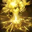
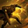
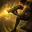
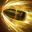
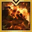

# Machinist (KR: 스카우터) — Arthetinean Skill, Solo Mode, no Ark Grid

No source had a Solo-Mode-specific Arthetinean Skill code. These are general pre-grid (no cores) raid builds from KR guides posted after the latest Machinist rework (2026-02-11).

- **Class / spec:** Machinist (KR: 스카우터), Arthetinean Skill (KR: 아르데타인의 기술)
- **Content:** Solo Mode
- **Ark Grid:** none, no cores
- **Engraving / stat preferences:** none stated

## Skill legend

Skill, rune, gem and Ark Passive names are global client names, matched to the KR names by game ID through lostarkcodex.com (US vs KR locale); Ark Passive nodes (Blunt Thorn, Master, Pulverize, Tactical Reload) come from the Lost Ark Wiki and Maxroll. The rune the original left unconfirmed (비전) is Vision in the codex rune list. Icons in `assets/icons/scouter/` were downloaded from lostarkcodex.com and converted to 32px PNG.

| Icon | Global name | KR name | Role |
|---|---|---|---|
|  | Overcharged Battery | 과충전 배터리 | Battery skill; swappable for Pulse Fire if battery runs dry |
|  | Mobile Shot | 기동 타격 | Opener, used ×3 |
|  | Avalanche | 아발란체 | Push-immune; first tripod can be battery charge |
|  | Strategic Fire | 전술 사격 | Push-immune; used after the drone skills |
|  | Command: Baby Drones | 명령 : 베이비 드론 | Drone skill, first in the drone order |
|  | Command: Raid Missile | 명령 : 레이드 미사일 | Drone skill, second in the drone order |
|  | Command: Carpet | 명령 : 카펫 | Drone skill, third in the drone order |
|  | Energy Buster | 에너지 버스터 | Used right after the hyper awakening skill |
|  | Pulse Fire | 펄스 파이어 | Battery-fix swap for Overcharged Battery |
|  | Annihilation Mode | 어나힐레이션 모드 | Long channel; replaces Strategic Fire in the 332 runner-up tree |

KR gem abbreviations in the source: 겁 = Doom (damage), 작 = Blaze (cooldown).

## Pick: 431 tree (3 normal / 4 drone / 1 joint)

```
F132875772217D4FE0834164438D019A9A61AD32C6CBDDD8FDC25F0E9B052AF4CF195B732A622F90086647EA8A4EACA0A5716CB7328D94C9EFF4A2D4C9B22381
```

- **Source:** https://www.inven.co.kr/board/lostark/5631/91329 ("기술스카 아크그리드 전 가이드", 2026-05-03), a pre-Ark-Grid guide for new and returning players.
- **Jev:** pick probability 0.67, fits-brief probability 0.70.
- **Why solo:**  Strategic Fire and  Avalanche are both push-immune, and there is no long  Annihilation Mode channel.

### Skills

Gems: Doom (damage) / Blaze (cooldown).

| Skill | Level | Tripods | Rune | Gems |
|---|---|---|---|---|
|  Overcharged Battery | 8 | 2/1 | Bleed | — |
|  Mobile Shot | 7 | 3/2 | Quick Recharge | — |
|  Avalanche | 14 | 1/3/1 | Judgment | Doom |
|  Strategic Fire | 14 | 1/3/2 | Galewind | Doom + Blaze |
|  Command: Baby Drones | 14 | 2/1/1 | Quick Recharge (Epic) | Doom + Blaze |
|  Command: Raid Missile | 14 | 3/3/1 | Overwhelm | Doom + Blaze |
|  Command: Carpet | 14 | 3/3/1 | Conviction | Doom + Blaze |
|  Energy Buster | 14 | 2/3/2 | Vision | Doom + Blaze |

### Engravings

Grudge, Raid Captain, Mass Increase, Keen Blunt Weapon, Adrenaline.

- With relic books: Cursed Doll instead of Adrenaline if crit is over the cap.
- Stabilized Status is the other suggested option.

### Ark Passive

- **Evolution:** Blunt Thorn, target 119–120% crit. Take Master while Adrenaline is only legendary; switch it to Pulverize as the engraving levels up.
- **Enlightenment / Leap:** fill the main nodes first; Tactical Reload optional.

### Rotation

1. Open with  Mobile Shot ×3.
2. Then hyper awakening skill and  Energy Buster first; drones in order  Baby Drones →  Raid Missile →  Carpet.
3. Use  Strategic Fire after the drone skills, so you deal damage while the drones do.
4. Don't hold skills waiting for the Judgment rune to proc.

Reference video: https://www.youtube.com/watch?v=oU5L6MY42no

### Before the pull

Press Shift+X repeatedly to fill the gauge that powers joint skills, or use awakening on the pull, which fills it completely.

### Battery

Only natural regen, the Judgment rune, and tripods recover battery, so food is required. If you still run dry:

- swap  Overcharged Battery for  Pulse Fire (2/3), or
- change  Avalanche's first tripod to battery charge.

The guide describes the joint-skill battery bonus as a refund; the 2026-07-22 patch changed it to a cost reduction. The tree is unaffected.

## Runner-up: 332 tree, same guide

```
54AF56B9814E5F485037D6B9070064629CF26B71EAC1AD1A54E19163F69D66D2C4387913F7A76BA9249EC1F5E8E8868FFD8B1A702EE10996DB3557FCDCA4804F
```

- **Source:** https://www.inven.co.kr/board/lostark/5631/91329 (2026-05-03)
- **Jev:** pick probability 0.25.
- **Difference:**  Annihilation Mode replaces  Strategic Fire. More damage and the author's main pre-grid tree, but one fewer push-immune skill. Carries over better to the 111 / 333 core sets later.

## Other option

https://www.inven.co.kr/board/lostark/5631/90852 (2026-03-20) has a 422 tree (4 normal / 2 drone / 2 joint). The author calls it the easiest for battery and drone control, but it does the least damage.

## Caveats

- **Global:** these are KR codes. They import correctly on global only if global has KR's 2026-02-11 Machinist rework, which is unconfirmed.
- **Solo videos:** the Solo Mode Arthetinean Skill videos found all predate that rework, so none were used.

# Machinist in the Paradise Crucible

Crucible (KR 낙원 증명) is Paradise's solo boss ladder, ranked per class. Only **skill levels and tripods** carry into Paradise: engravings, gems, runes, cards and the whole Ark Passive don't apply (official release notes; details in `paladin.md` → What applies in Paradise). So your raid spec (Arthetinean Skill) and Ark Grid don't matter here; only the skill bar, levels, tripods and awakening choice do.

These are KR codes, checked on [lostark.bible](https://lostark.bible/tools/skill-code) and uploaded to CE on 2026-10-15, so they import on EUC. Whether they play the same on global depends on global having KR's balance patches, which is unverified.

## Crucible skill legend

| Icon | Global name | KR name |
|---|---|---|
|  | Air Strike | 에어 스트라이크 |
|  | Annihilation Mode | 어나힐레이션 모드 |
|  | Avalanche | 아발란체 |
|  | Command: Baby Drones | 명령 : 베이비 드론 |
|  | Command: Carpet | 명령 : 카펫 |
|  | Command: Flare Beam | 명령 : 플레어 빔 |
|  | Command: Raid Missile | 명령 : 레이드 미사일 |
|  | Energy Buster | 에너지 버스터 |
|  | Mobile Shot | 기동 타격 |
|  | Neo Fire | 네오 파이어 |
|  | Overcharged Battery | 과충전 배터리 |

## Recommended Crucible code

```
29D7A32B12F2144095EAA8B1E2764FD65520413262C316D4DDF79157A07C175E744DB036BD056AA3CD512CCFCB9634C9917D8CE2D32931F81AF688A85AA5179C
```

- Source: [KR Season 4 page](https://sites.google.com/view/achi-loa/%EB%82%99%EC%9B%90/%EB%82%99%EC%9B%90-%EC%8B%9C%EC%A6%8C4): listed weeks 2–6 (2026-09-16 → 2026-10-14), Crucible stage 4–7.
- Awakening  Air Strike; hyper awakening  Neo Fire. No runes (they wouldn't apply anyway).
- Jev pick probability: **0.91**.

| Skill | Level | Tripods |
|---|---|---|
|  Overcharged Battery | 10 | Fighting Spirit Enh., Explosive Battery, Instant Explosion |
|  Command: Flare Beam | 14 | Enhanced Laser, Lightning Beam, Laser Cut |
|  Command: Baby Drones | 14 | One Body and Spirit, Flame Baby, All-out War |
|  Command: Raid Missile | 14 | One Body and Spirit, Organ Missile, Weak Point Detection |
|  Annihilation Mode | 11 | Domination Shot, Reformation, Comrade |
|  Mobile Shot | 7 | Solid Maneuver, Quickness |
|  Avalanche | 14 | Diversion, Zero Degree Aim, Concise Finish |
|  Energy Buster | 14 | Skilled Defender, Lightning Burster, Railgun |

## Runner-up

```
C4223FC21EC026A880796DDB75C65C64B95E3DC9F087C13CD6700088904F46A5DF32E4A95EB8F2147A7C427EECE0B34F85171B48ABF98486C7B595D200F7D5E6
```

- Source: [KR Season 3 page](https://sites.google.com/view/achi-loa/%EB%82%99%EC%9B%90/%EB%82%99%EC%9B%90-%EC%8B%9C%EC%A6%8C3): weeks 4–15 of Season 3 (2026-06-10 → 2026-08-26).
- Same awakening and hyper awakening as the recommended code.
- Differences from the recommended code:

  | Skill | Recommended | Runner-up |
  |---|---|---|
  |  Annihilation Mode | Lv11: Domination Shot, Reformation, Comrade | Lv14: Battery Saving Mode, Reformation, Comrade |
  |  Avalanche | Lv14: Diversion, Zero Degree Aim, Concise Finish | Lv14: Diversion, Neat Combination, Coup De Grace |
  |  Command: Carpet | not used | Lv14: Battery Saving Mode, Explosive Barrage, Weak Point Detection |
  |  Command: Flare Beam | Lv14: Enhanced Laser, Lightning Beam, Laser Cut | not used |
  |  Command: Raid Missile | Lv14: One Body and Spirit, Organ Missile, Weak Point Detection | Lv14: Battery Discharge, Organ Missile, Weak Point Detection |
  |  Energy Buster | Lv14: Skilled Defender, Lightning Burster, Railgun | Lv14: Condense, Flame Buster, Meltdown |
  |  Mobile Shot | Lv7: Solid Maneuver, Quickness | Lv7: Quick Prep, Quickness |
  |  Overcharged Battery | Lv10: Fighting Spirit Enh., Explosive Battery, Instant Explosion | Lv8: Fighting Spirit Enh., Explosive Battery |

## Notes and Restoration order

- The author marks Machinist as not using its identity gauge, and says the class needs drone control that he struggles with.
- Season 3 note: consider casting skills after transforming.

Restoration order (the author's, for a class that doesn't use its identity gauge; each number is the slot's Restoration level, and slot effects are in `paladin.md` → Restoration priority):

- **Phase 1 (levels 1–4, week 1):** Mask 1 → Liquor Glass / Bell / Mirror 2 → Mask / Censer / Whistle 2 → Whistle 3 → Liquor Glass 3 → Mask 4 → Bell / Mirror 3 → Censer 4 → the rest to 4. This skips the identity-meter steps (Censer 1, Whistle 4).
- **Phase 2 (level 6):** Censer 6 → Liquor Glass 6 → Mask 6 → Bell / Mirror 6.
- **Phase 3 (level 9):** Liquor Glass 9 first (hyper awakening cooldown), then Censer 9, then the rest.
