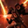

# Machinist (KR: 스카우터) — Evolutionary Legacy, Solo Mode

**Evolutionary Legacy** (KR: 진화의 유산) rates A / A+ / B on the Inven lists of Oct 20 / Oct 18 / Extreme Mordum Oct 6, avg 6.3, the highest of the two Machinist engravings (`tierlist.md`).

- **Class / spec:** Machinist (KR: 스카우터), Evolutionary Legacy (Evolution node: Standing Striker, KR 입식 타격가)
- **Content:** Solo Mode (gold-funnel alt). Every build below is a raid build; no source targets Solo Mode, and none tests Legacy's weak points (transformation dropping in cutscenes, crit-dependent damage) there.
- **Item level 1646.66:** pre-grid now; Ark Grid unlocks at 1700, so the 333 section below is for later.
- **Region:** CE. The codes are KR builds imported to CE (checked on [lostark.bible](https://lostark.bible/tools/skill-code)); whether they play like KR depends on global having KR's balance patches (unverified).
- **Sources:** Inven Machinist board, [유산 스카우터 가이드 Ver. 2026.07.08](https://www.inven.co.kr/board/lostark/5631/91652) (posted 2026-06-24, updated 2026-07-08; author 팡굥이, pre-grid build credited to 지훌) and [퀘이사 유산 스카우터 가이드 (222)](https://www.inven.co.kr/board/lostark/5631/89938) (Q&A updated 2026-07-22). Popularity from [loagg](https://loagg.com/stats/setting/%EC%A7%84%ED%99%94%EC%9D%98%20%EC%9C%A0%EC%82%B0) (508 characters at item level 1720+, updated 2026-09-17).

## How the spec plays

- **Infinite transformation.** Once transformed (the Zero Sync gauge, which the author calls Aden, 아덴, must be full to enter) you stay transformed, so you play the transformed set Q W E R A S, the Zero Sync skills D F X and the hyper awakening T.
- **Zero Sync skills enhance and refresh.** D enhances E and A, F enhances S and R, X enhances E A S R; each cuts those skills' cooldown by 4 s. Zero Mode's node level decides which are unlocked: 1 = X, 2 = D, 3 = F (the code has Zero Mode 3).
- **Rotation in one line:** fire D / F / X as soon as they are ready so the next enhanced skill is pre-loaded, throw Q and W (Quick Recharge procs, battery, repositioning) while everything is on cooldown, and use E+A and S+R as pairs so their cooldowns stay aligned.
- **Upsides (author):** solid damage, good stagger (E A R S enhanced raise stagger by one tier), shield refresh when Zero Sync is used, strong counters (pre-input counters work).
- **Downsides (author):** low crit means large DPS swings, the transformation drops in cutscenes, and the engraving setup is expensive.

## Skill legend

The Key column is the authors' shorthand; the 89938 guide spells out Q W E A R S D F X T, and the transformed skills sit in the code in that key order. "V", the opener in the 91652 cycles, is read as the awakening skill (Air Strike) — inferred, not stated.

| Icon | Key | Global name | KR name | Role |
|---|---|---|---|---|
|  | Q | Comet Strike | 코멧 스트라이크 | Transformed basic; Quick Recharge, battery, reposition; used between everything |
|  | W | Slugshot | 슬러그 샷 | Transformed basic; filler |
|  | E | Laser Blade | 레이저 블레이드 | Sync skill enhanced by D / X; used with A |
|  | A | Surge Blow | 버스트 블로우 | Sync skill enhanced by D / X; used with E |
|  | R | Echelon Beam | 엑셀리온 빔 | Sync skill enhanced by F / X; used with S; 16 s cooldown |
|  | S | Crimson Breaker | 크림슨 브레이커 | Sync skill enhanced by F / X; used with R; 20 s cooldown |
|  | D | Sonic Impact | 소닉 임팩트 | Zero Sync: enhances E and A, -4 s on their cooldowns |
|  | F | Quantum Assembly Beam | 퀀텀 어셈블리 빔 | Zero Sync: enhances S and R, -4 s on their cooldowns |
|  | X | EX-Zero Point | EX - 제로 포인트 | Zero Sync: enhances E A S R, -4 s on their cooldowns |
|  | T | Point Exclusion | 포인트 익스클루션 | Hyper awakening; Release Potential shortens its cooldown |
|  | V | Air Strike | 에어 스트라이크 | Awakening skill in these codes |
|  | — | Overcharged Battery | 과충전 배터리 | Battery skill, thrown mid-fight when Aden synergy is missing |
|  | — | Command: Flare Beam | 명령 : 플레어 빔 | Normal skill; helps fill the Aden gauge |
|  | — | Command: Baby Drones | 명령 : 베이비 드론 | Normal skill; helps fill the Aden gauge |
|  | — | Command: Raid Missile | 명령 : 레이드 미사일 | Normal skill; helps fill the Aden gauge |
|  | — | Energy Buster | 에너지 버스터 | Normal skill; helps fill the Aden gauge |
|  | — | Mobile Shot | 기동 타격 | Normal skill, mobility |
|  | — | Avalanche | 아발란체 | Normal skill |
|  | — | Annihilation Mode | 어나힐레이션 모드 | Normal skill (long channel) |

KR gem abbreviations in the sources: 겁 = Doom (damage), 작 = Blaze (cooldown). `평` in a rotation means a basic attack. `단심` = Conviction rune on W plus Judgment rune on S (KR community name for that pairing).

## Pre-grid (below 1700): use this now

### Pick: 지훌's pre-grid build

```
16042235074296FCF2A10FAEE29B9CCB66994212D5C69B451FBDF9B6FDC0D2B0188E5DD00A3FA343E6AEC68B188092E1DC3AF1BB00B6D7BF4AADA1BD970D8B5F
```

- **Source:** https://www.inven.co.kr/board/lostark/5631/91652 (section "아크그리드 이전 세팅").
- **From the code:** Standing Striker 2; Evolution Crit 9, Specialization 30, Swiftness 1, Keen Sense 1, Optimized Training 2, Zealous Smite 2, Master 1, Pulverize 1; Enlightenment Evolutionary Legacy 3, Oversync 3, Combat Mode 3, Zero Mode 3, Core Reaction Amplification 1, Zero Core Energy 1; Leap Unleashed Power 5, Release Potential 4, Sync Combination 3, Instant Spell 2. Awakening Air Strike, hyper awakening Point Exclusion. Engravings: Grudge, Keen Blunt Weapon, Raid Captain, Adrenaline, Mass Increase.

| Skill | Level | Tripods | Rune |
|---|---|---|---|
|  Overcharged Battery | 10 | Fighting Spirit Enh., Continuous Explosion, Instant Explosion | — |
|  Command: Flare Beam | 10 | Scar, Core Energy Charge, Laser Show | — |
|  Command: Baby Drones | 14 | Enhanced Self-Destruct, Core Energy Supply, Roundup Attack | Wealth |
|  Command: Raid Missile | 14 | Core Energy Charge, Organ Missile, Weak Point Detection | Wealth |
|  Annihilation Mode | 14 | Domination Shot, All-around Security, Comrade | — |
|  Mobile Shot | 10 | Solid Maneuver, Quickness, Evasive Maneuver | — |
|  Avalanche | 10 | Diversion, Zero Degree Aim, Concise Finish | — |
|  Energy Buster | 14 | Skilled Defender, Tenacity, Meltdown | — |
|  Q Comet Strike | fixed | — | Quick Recharge |
|  W Slugshot | fixed | — | Quick Recharge |
|  E Laser Blade | fixed | — | Quick Recharge |
|  R Echelon Beam | fixed | — | Galewind |
|  A Surge Blow | fixed | — | Quick Recharge |
|  S Crimson Breaker | fixed | — | Galewind |

Runes the author prescribes (his note says runes are taste, no right answer): Q legendary Quick Recharge, W epic Quick Recharge, E and A rare Quick Recharge (Vision, Bleed or Poison also fine), R and S legendary Galewind; Conviction on W and Judgment on S are allowed (the 단심 pairing). Baby Drones epic Wealth, Raid Missile legendary Wealth (89938).

#### Gems

- Doom: E, R, A, S, D, F. Blaze: Q, S, D, F, X.
- R has a 16 s cooldown and S a 20 s one; an 8 Blaze on S makes R and S come back together.

#### Engravings

- Fixed: Grudge, Keen Blunt Weapon, Raid Captain, Adrenaline.
- Fifth, pick one: Cursed Doll, Mass Increase, or Hit Master.
- The author advises against Barricade on a main: shield gaps appear when a cutscene or a heavy hit with no support care breaks the shield or leaves you transformed.
- Ability stone: take two of Keen Blunt Weapon / Adrenaline / Raid Captain (89938).

#### Ark Passive

- If specialization / crit looks wrong after pasting, set Specialization 30 and Crit 10 (author). loagg: 259 of 277 characters on the 333 set run Crit 10.
- Leap tier 2: Sync Combination or Autopilot is taste. With Autopilot, put all 5 points in the tier-1 cooldown node (Release Potential) and use T before D / F / X in the opener so T takes Autopilot's 5 s reduction.

#### Rotation (author's cycle, key letters as in the legend)

1. T, X, E Q A S R, Q, D, F, E Q A, Q W Q, basic attack, S R, D, E Q A.
2. X, S R, E Q A, Q W Q, basic attack, D, E Q A, Q W Q, F, S R, Q W Q, basic attack.
3. X, E Q A, D, Q W Q, E Q A S R, Q W Q, D, E Q A, then align cooldowns and restart at 1.

#### Getting transformed

- Normal way: eat an awakening potion (각물) before entering so the Aden gauge starts full.
- If the potion is wasteful: use the awakening at the pull (the author notes the hyper awakening is then harder to fit).
- Without a potion (89938): Flare Beam, Baby Drones, Raid Missile and Energy Buster alone fill Aden; throw Overcharged Battery once because there is no synergy, and do not cancel Flare Beam before its Laser Show tripod hits finish, or the gauge doesn't fill.

### Runner-up: 333 RS build, same tree

```
2568EAACAEDF54BD6C8AA06B90CB75E8B0211FC402421738E6A4AAD301214559ED0C84EC9327FDED1778E897445C032071F7935C3BBE8FCAE2C5AB0328B0D7B5
```

- **Source:** https://www.inven.co.kr/board/lostark/5631/91652 (section "333 RS겁 세팅").
- **Difference:** same skill bar, runes, awakening and Ark Passive as the pick; only the engraving (Cursed Doll instead of Mass Increase, which carries an attack-speed penalty) and the stored cores and gems differ. Use it if you'd rather run Cursed Doll now; you will use it again at 1700+.

## 1700+: Ark Grid 333 (most common set)

loagg (508 characters at 1720+): 277 (55%) run **333**, i.e. Order Sun **Titan Suit** (타이탄 슈트), Moon **Assault Titan** (어썰트 타이탄), Star **Core Reactor Amplification** (코어 리액터 증폭). Everyone on 333 runs Standing Striker with Adrenaline and Grudge.

Chaos cores for the 333 group: Sun Flashy Attack (현란한 공격), Moon Smoldering Strike (불타는 일격), Star Attack (공격).

### Pick: 333 RS (RS 겁)

```
2568EAACAEDF54BD6C8AA06B90CB75E8B0211FC402421738E6A4AAD301214559ED0C84EC9327FDED1778E897445C032071F7935C3BBE8FCAE2C5AB0328B0D7B5
```

- **Source:** https://www.inven.co.kr/board/lostark/5631/91652 (2026-06-24, updated 2026-07-08).
- **Why this one (author):** it fits players with only about two high-level gems, no full Cursed Doll / Mass Increase relic engraving but a Hit Master or Cursed Doll one, or a party that always provides crit synergy. Titan Suit's 4-stack option enhances D and lets F also give E / A the 4 s cooldown reduction; Assault Titan makes Q enhance E / A.
- **Engravings:** Grudge, Keen Blunt Weapon, Raid Captain, Adrenaline, Cursed Doll.
- **Damage share (author):** D 20, E 19, T 13, A 12, F 11, R 6, S 6. D and E carry 40%, so put gem levels there first.
- **Gems:** Doom E A D F R S (priority D > E > A > F > R > S); Blaze E A D X F (priority E > A > D > F > X); keep E and A Blaze levels equal.

#### Cycle

- **Encounter:** V, Q W, E Q A, T, D, E Q A, F, S, E Q A, R, X, Q W, E Q A.
- **Encounter with 단심:** Q W (Conviction on W), E Q A, S (Judgment on S), T, D, E Q A, F, R, E Q A, X, Q W, E Q A.
- **After that:** Zero Sync priority D, F, X.
  - E / A about 1 s from ready and D, F, X all on cooldown: use Q W E Q A (Quick Recharge procs).
  - E / A about 2 s away and D, F, X all waiting: drop the cooldown reduction and cast D first (unblocks the bottleneck).
  - E / A about 1 s away: cast E Q A first, then the Zero Sync skill, to get the full 4 s reduction.
- Author's own caveat: the damage multipliers in the videos predate the 2026-07-22 balance patch.

### Alternative with the same cores: 333 QEQA (Q-spam, high skill)

```
A28DCEFAE41478E697E3949418FC41EDCA955EC288A00E9983079BFDFB54FD07693DF92F96C2A01C781FBA6010D0ADD10EF77C390E73BD562AE1A70AE95FF0F1
```

- **Source:** https://www.inven.co.kr/board/lostark/5631/91652 (채만준's build with the 단심 cycle). Max-ceiling, high-skill option, not the easy pick.
- **Difference:** Blaze goes on Q instead of R / S (Doom E A D F Q, priority E > D > A > F > Q; Blaze E A D F Q X, priority Q > E > A > D > F > X) and the rotation spams Q E Q A for more Quick Recharge procs. Needs a level 10 Blaze on Q; with a cooldown-reduction bracelet Q E Q A stutters, so put 1–2 points into Swiftness. Per the code, runes change on three transformed skills: W legendary Conviction, S legendary Judgment, E epic Quick Recharge (the 단심 pairing). Skill levels, tripods, awakening, Ark Passive and engravings are otherwise the same as the pick.
- **Cycle:** Q E Q A, V, T X, Q E Q A, D, Q W, Q E Q A, F, Q E Q A, Q W, Q R, W (Conviction) S (Judgment); then keep using Q E Q A, filling gaps with Q W and Q R. Zero Sync priority D, F, X.

## Caveats

- **2026-07-22 patch:** the author of the 222 guide says 333 and 133 were nerfed and 222 buffed that day. The 333 codes and numbers in 91652 were last edited 2026-07-08, so they predate the patch. loagg still shows 333 as the most common set among 1720+ players.
- **Skill levels:** the codes carry levels up to 14; if your skill points can't cover them, expect to adjust.

# Machinist in the Paradise Crucible

Crucible (KR 낙원 증명) is Paradise's solo boss ladder, ranked per class. Only **skill levels and tripods** carry into Paradise: engravings, gems, runes, cards and the whole Ark Passive don't apply (official release notes; details in `paladin.md` → What applies in Paradise). So your raid spec (Evolutionary Legacy) and Ark Grid don't matter here; only the skill bar, levels, tripods and awakening choice do.

These are KR codes, checked on [lostark.bible](https://lostark.bible/tools/skill-code) and uploaded to CE on 2026-10-15, so they import on EUC.

## Crucible skill legend

| Icon | Global name | KR name |
|---|---|---|
|  | Air Strike | 에어 스트라이크 |
|  | Annihilation Mode | 어나힐레이션 모드 |
|  | Avalanche | 아발란체 |
|  | Command: Baby Drones | 명령 : 베이비 드론 |
|  | Command: Carpet | 명령 : 카펫 |
|  | Command: Flare Beam | 명령 : 플레어 빔 |
|  | Command: Raid Missile | 명령 : 레이드 미사일 |
|  | Energy Buster | 에너지 버스터 |
|  | Mobile Shot | 기동 타격 |
|  | Neo Fire | 네오 파이어 |
|  | Overcharged Battery | 과충전 배터리 |

## Recommended Crucible code

```
29D7A32B12F2144095EAA8B1E2764FD65520413262C316D4DDF79157A07C175E744DB036BD056AA3CD512CCFCB9634C9917D8CE2D32931F81AF688A85AA5179C
```

- Source: [KR Season 4 page](https://sites.google.com/view/achi-loa/%EB%82%99%EC%9B%90/%EB%82%99%EC%9B%90-%EC%8B%9C%EC%A6%8C4): listed weeks 2–6 (2026-09-16 → 2026-10-14), Crucible stage 4–7.
- Awakening  Air Strike; hyper awakening  Neo Fire. No runes (they wouldn't apply anyway).

| Skill | Level | Tripods |
|---|---|---|
|  Overcharged Battery | 10 | Fighting Spirit Enh., Explosive Battery, Instant Explosion |
|  Command: Flare Beam | 14 | Enhanced Laser, Lightning Beam, Laser Cut |
|  Command: Baby Drones | 14 | One Body and Spirit, Flame Baby, All-out War |
|  Command: Raid Missile | 14 | One Body and Spirit, Organ Missile, Weak Point Detection |
|  Annihilation Mode | 11 | Domination Shot, Reformation, Comrade |
|  Mobile Shot | 7 | Solid Maneuver, Quickness |
|  Avalanche | 14 | Diversion, Zero Degree Aim, Concise Finish |
|  Energy Buster | 14 | Skilled Defender, Lightning Burster, Railgun |

## Runner-up

```
C4223FC21EC026A880796DDB75C65C64B95E3DC9F087C13CD6700088904F46A5DF32E4A95EB8F2147A7C427EECE0B34F85171B48ABF98486C7B595D200F7D5E6
```

- Source: [KR Season 3 page](https://sites.google.com/view/achi-loa/%EB%82%99%EC%9B%90/%EB%82%99%EC%9B%90-%EC%8B%9C%EC%A6%8C3): weeks 4–15 of Season 3 (2026-06-10 → 2026-08-26).
- Same awakening and hyper awakening as the recommended code.
- Differences from the recommended code:

  | Skill | Recommended | Runner-up |
  |---|---|---|
  |  Annihilation Mode | Lv11: Domination Shot, Reformation, Comrade | Lv14: Battery Saving Mode, Reformation, Comrade |
  |  Avalanche | Lv14: Diversion, Zero Degree Aim, Concise Finish | Lv14: Diversion, Neat Combination, Coup De Grace |
  |  Command: Carpet | not used | Lv14: Battery Saving Mode, Explosive Barrage, Weak Point Detection |
  |  Command: Flare Beam | Lv14: Enhanced Laser, Lightning Beam, Laser Cut | not used |
  |  Command: Raid Missile | Lv14: One Body and Spirit, Organ Missile, Weak Point Detection | Lv14: Battery Discharge, Organ Missile, Weak Point Detection |
  |  Energy Buster | Lv14: Skilled Defender, Lightning Burster, Railgun | Lv14: Condense, Flame Buster, Meltdown |
  |  Mobile Shot | Lv7: Solid Maneuver, Quickness | Lv7: Quick Prep, Quickness |
  |  Overcharged Battery | Lv10: Fighting Spirit Enh., Explosive Battery, Instant Explosion | Lv8: Fighting Spirit Enh., Explosive Battery |

## Notes and Restoration order

- The author marks Machinist as not using its identity gauge, and says the class needs drone control that he struggles with.
- Season 3 note: consider casting skills after transforming.

Restoration order (the author's, for a class that doesn't use its identity gauge; each number is the slot's Restoration level, and slot effects are in `paladin.md` → Restoration priority):

- **Phase 1 (levels 1–4, week 1):** Mask 1 → Liquor Glass / Bell / Mirror 2 → Mask / Censer / Whistle 2 → Whistle 3 → Liquor Glass 3 → Mask 4 → Bell / Mirror 3 → Censer 4 → the rest to 4. This skips the identity-meter steps (Censer 1, Whistle 4).
- **Phase 2 (level 6):** Censer 6 → Liquor Glass 6 → Mask 6 → Bell / Mirror 6.
- **Phase 3 (level 9):** Liquor Glass 9 first (hyper awakening cooldown), then Censer 9, then the rest.
