Solo Mode gold-funnel alt at 1645.5, no Ark Grid yet (it opens at 1700). Deathblow replaces Esoteric Flurry: the Inven tier lists in [tierlist.md](tierlist.md) rate it S- / A / A (avg 7.7) against 3.5.
Codes are KR builds imported to CE; whether they play like KR depends on global having the same balance patches. No source posts a code made for Solo Mode.

## Play this now

Pre-grid 111 호령 Deathblow ("1 hyper-awakening + Charging Kick"; 호령 is the KR name of the 111 core set, global Order Sun core Tiger's Roar). Needs Orb's Blessing; use it until you have Ark Grid cores at 1700.

```
9BA1B7EE572C926E321F1DF4305892D6B2888E5FFF5A04B1349EC56882855A537825579789BCED26C6DDA615F818F9C08DC0528743245AE6C0D75EE28B4F771A
```

- Source: Inven Striker board, https://www.inven.co.kr/board/lostark/5709/108617 (2026-02-11); Ark Passive, skills, opener and gem order from the 2025-12-13 Deathblow guide, https://www.inven.co.kr/board/lostark/5709/107336
- What the code holds: Deathblow I 3 / Deathblow II 3 / Orb's Blessing 3, Evolution Crit 10 / Specialization 30, hyper awakening  Charging Kick, runes on 7 of 8 leveled skills
- For a no-grid character, change 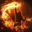 Tiger Emerges's Tenacity tripod to Extreme Efficiency (Inven 110264)
- Commenters say it plays identically to Deathblow 111: "same skill code, same play" (Inven 111506, 2026-07-03)

## How it plays

- **Core loop:** normal skills fill 4 orbs → spend all 4 on an Esoteric skill → after 16 orbs, Z →  Charging Kick, the 16-orb finisher (1640 unlocks the hyper-awakening skill).
- **Orb rule:**  Sky Shattering Blow and 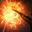 Vicious Tiger Dance give 1.5 orbs;  Moon Flash Kick,  Sweeping Kick and 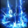 Lightning Whisper give 2.5; 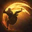 Storm Dragon Kick gives 1. A missed builder hit leaves you short of 4 orbs.
- **Back attacks matter:** the builds are crit-dependent (every non-crit hurts; Blunt Thorn is not recommended) and the 333 build below requires them.
- **One Ark Passive node picks your build:** Orb's Blessing (Enlightenment tier 4, needs 80 Enlightenment points; check yours in game). With it, play the pick above; without it, the 3-Esoteric tree under Other builds.
- Main difficulty: orb counting under pressure, since one missed builder breaks the 4-orb cycle.

## Setup

- **Engravings:** Grudge, Adrenaline, Ambush Master, Super Charge + Hit Master or Precise Dagger
- **Stats and Ark Passive:**
  - Evolution: Crit 10 / Spec 30, Limit Break 3, Strike 2, Critical 1 + Pulverize 1, Standing Striker 2. Avoid Blunt Thorn
  - Enlightenment: everything through tier 4, plus Lethal Esoteric Skill 1 and Fully Charged 1. If you're short on points, take Fully Charged right after tier-4 level 3
  - Leap: Transcendent Power 1, Unleashed Power 5, Release Potential 3, Instant Spell 2, Efficient Strike 3
- **Gems:** upgrade order:  Sky Shattering Blow Blaze =  Vicious Tiger Dance Blaze > 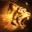 Lightning Tiger Strike Doom > 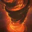 Call of the Wind God Doom >  Lightning Whisper Blaze /  Sweeping Kick Blaze /  Sweeping Kick Doom >  Moon Flash Kick Blaze >  Storm Dragon Kick Blaze
- **Cards:** Light of Salvation once you use Charging Kick; Three Umar Families 3 + Fate of the Lazeniths 2 for the 3-Esoteric tree

Shared by every code below unless a build says otherwise. The pick's skills:

| Skill | Lv | Tripods | Rune |
|---|---|---|---|
|  Sky Shattering Blow | 10 | 132 | Legendary Wealth |
|  Storm Dragon Kick | 10 | 122 | Legendary Quick Recharge |
|  Moon Flash Kick | 12 | 312 | Rare Wealth |
|  Vicious Tiger Dance | 12 | 211 | Epic Wealth |
|  Lightning Whisper | 10 | 331 | Rare Wealth |
|  Lightning Tiger Strike | 14 | 211 | Legendary Galewind |
|  Call of the Wind God | 14 | 311 | Epic Quick Recharge |
|  Sweeping Kick | 14 | 111 | Epic Wealth |

Short on skill points? Drop Storm Dragon Kick to 4 and Moon Flash Kick / Vicious Tiger Dance to 10.

## Rotation

1.  Storm Dragon Kick ×3 →  Sky Shattering Blow →  Lightning Whisper →  Lightning Tiger Strike (6 Adrenaline stacks)
2.  Vicious Tiger Dance →  Moon Flash Kick →  Call of the Wind God
3.  Sky Shattering Blow →  Sweeping Kick →  Lightning Tiger Strike
4.  Vicious Tiger Dance →  Storm Dragon Kick →  Sky Shattering Blow →  Call of the Wind God
5. Z →  Charging Kick

From the second cycle, swap the order of Sky Shattering Blow and Vicious Tiger Dance. Clock check on a Trixion dummy: run it for 2 minutes; the 6th Charging Kick lands around 1:57–1:58 (Inven 95470), and if it slips past 2:00, DPS reads low.

## Other builds

### Without Orb's Blessing — 3-Esoteric tree (no code)

No skill code exists for this tree (only 111/333 Charging Kick codes turned up), so set it up by hand. Source: Inven 95470 (certified, last updated 2025-02-26), so the numbers are dated. Switch to the pick as soon as you reach 80 Enlightenment points: at Orb's Blessing level 1 the Charging Kick build does about the same damage.

| Skill | Lv | Tripods | Rune |
|---|---|---|---|
|  Lightning Tiger Strike | 14 | 211 | Legendary Galewind |
|  Call of the Wind God | 14 | 311 | Legendary Bleed or Epic Conviction |
|  Tiger Emerges | 14 | 3 2 1/2 | Legendary Overwhelm or Galewind |
|  Sweeping Kick | 14 | 1/2 1 1 | Epic Wealth |
|  Vicious Tiger Dance | 10 | 211 | Epic Wealth |
|  Sky Shattering Blow | 10 | 1/3 3 2 | Legendary Wealth |
|  Lightning Whisper | 10 | 3 1/3 1 | Rare Wealth |
|  Storm Dragon Kick | 10 | 122 | Legendary Quick Recharge or Purify |

- Hyper awakening: 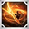 Advancing Strike
- Cards: Three Umar Families 3-set + Fate of the Lazeniths 2-set
- Rotation (repeat):
  1.  Sky Shattering Blow +  Lightning Whisper →  Lightning Tiger Strike
  2.  Sweeping Kick +  Vicious Tiger Dance →  Tiger Emerges
  3.  Sky Shattering Blow +  Storm Dragon Kick +  Vicious Tiger Dance → 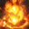 Blast Formation /  Call of the Wind God

### Runner-up — Deathblow 111, video build

```
253845C4DBD9244BDCE061752C9A31DD65641048936E876FFDBCD6D2B3AB4AA83111266B188681727E25B76FD055AC44CAF9098100C08AEC1C7480E876F4D014
```

- Source: short Deathblow how-to video, https://www.youtube.com/watch?v=T6VlNucYmlc (2025-12-20)
- Difference from the pick: same Ark Passive (Orb's Blessing 3, Crit 10 / Specialization 30), runes on all 8 leveled skills. The core set isn't stated, and the video has an Ark Grid chapter

### At 1700+ — Deathblow 333 (월방)

월방 is the KR name for the 333 set, built around Moon Flash Kick + Sweeping Kick. Switch once you have the cores with at least 14 points active in each (Inven 109943: open the grid at 1700, get the cores, activate 14+ points); all-Legendary cores are enough.

```
6140B83AFE461EA8927BCB3B0552AB53D3FD46669F88D64D13CFC187336221B3B148343F34BE299DBDB31861F8DF9F2B8F8A46282ED534D9EE201C4A9845834E
```

- Source: https://www.inven.co.kr/board/lostark/5709/110922 (2026-06-24)
- What the code holds: Crit 7 / Specialization 30 / Swiftness 3 / Keen Sense 1, Limit Break 2, Orb's Blessing 3, runes on all 8 leveled skills
- Core loop: fill 4 orbs →  Lightning Tiger Strike ×4 → 16-orb  Charging Kick
- Author's verdict: fun; how well you recover from mistakes decides your ceiling. Back attack required, push immunity poor

### At 1700+ runner-up — Deathblow 333, Galewind rune

```
705E43B45DCE3921E3A0708F9AEDB36E431A08DDB3BE20BC88F89B795ACCBE6CEDD53C8E0F1FB5C6634287CCD596A06D2FFB0C09C248A307EA473D1CD30094FC
```

- Source: https://www.inven.co.kr/board/lostark/5709/109113 (2026-03-02)
- Difference: Galewind rune; Crit 8 / Specialization 30 / Swiftness 2, Limit Break 3

## Caveats

- No source posts a code made for Solo Mode, so none of these is tested there.
- The 3-Esoteric tree comes from a 2025-02 guide and may be out of date.

## Paradise Crucible

Crucible (KR 낙원 증명) is Paradise's solo boss ladder. Only skill levels and tripods carry into Paradise (details in [paladin.md](paladin.md#paradise-crucible)). These are KR codes, checked on [lostark.bible](https://lostark.bible/tools/skill-code) and uploaded to CE on 2026-10-15.

### Pick

```
05DEEBE03FFFDDCA07543B04E51476B01717EDB8C0923A2789D5DB3FB5F5DC2BFF5E0E54DB624594EB2E96EFDCF78A059422EB0FA7B57EBC4A6D6F984578F2AD
```

- Source: [KR Season 4 page](https://sites.google.com/view/achi-loa/%EB%82%99%EC%9B%90/%EB%82%99%EC%9B%90-%EC%8B%9C%EC%A6%8C4), weeks 2–6 (2026-09-16 → 2026-10-14); Crucible stage 4–7 (stage 7 in week 6)
- Awakening 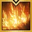 Potent Heavenly Kick; hyper awakening  Advancing Strike

| Skill | Level | Tripods |
|---|---|---|
|  Lightning Whisper | 10 | Weakness Exposure, Afterimages of Lightning, Efficient Extortion |
| 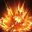 Berserk Circle | 14 | Focus Attack, Weak Point Detection, Volcanic Eruption |
|  Lightning Tiger Strike | 14 | Enhanced Strike, Weak Point Detection, Consecutive Kick |
|  Call of the Wind God | 14 | Lightning Storm, Growth Attack, Summon Storm |
|  Storm Dragon Kick | 5 | Excellent Mobility |
|  Sky Shattering Blow | 13 | Swift Footwork, Blessing of the Wind, Abundant Resources |
|  Vicious Tiger Dance | 14 | Focus Attack, Focus Hit, Tiger Fang |
|  Sweeping Kick | 14 | Weak Point Detection, Light of Justice, Pure Excellence |

### Runner-up

```
255082C16437D3A7FA4EA00921A473D0031AEC5291FD4D88BEE8F4E268653EE811FA55F98D8F19902D531C72CCC6156F24394BF7B562096E0EFCFAA2E9C69FBE
```

- Source: [KR Season 3 page](https://sites.google.com/view/achi-loa/%EB%82%99%EC%9B%90/%EB%82%99%EC%9B%90-%EC%8B%9C%EC%A6%8C3), last Season 3 code (to 2026-08-26), a 4-Esoteric-skill bar
- Awakening 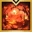 Nova Blast; hyper awakening  Advancing Strike. Differences from the pick:

| Skill | Pick | Runner-up |
|---|---|---|
|  Blast Formation | not used | Lv14: Flame Explosion, Focus Explosion, Final Explosion |
|  Tiger Emerges | not used | Lv14: Tenacity, Enhanced Strike, Hoseunggyuk |
|  Sweeping Kick | Lv14: Weak Point Detection, Light of Justice, Pure Excellence | not used |
|  Vicious Tiger Dance | Lv14: Focus Attack, Focus Hit, Tiger Fang | not used |

### Restoration order

The author's order for a class that uses its identity gauge (slot effects in [paladin.md](paladin.md#paradise-crucible)):

- **Phase 1 (levels 1–4, week 1):** Mask 1 → Censer 1 → Liquor Glass / Bell / Mirror 2 → Mask / Censer / Whistle 2 → Whistle 3 → Liquor Glass 3 → Whistle 4 → Bell / Mirror 3 → Censer 4 → the rest to 4
- **Phase 2 (level 6):** Censer 6 → Liquor Glass 6 → Whistle 6 → Mask 6, then Bell / Mirror
- **Phase 3 (level 9):** Liquor Glass 9 first (hyper awakening cooldown), then Censer 9, then the rest
