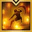
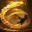

Pre-grid First Intention for a 1640 character in Solo Mode. [tierlist.md](tierlist.md) rates it S / A+ / B (avg 7.3) against Esoteric Skill Enhancement's 4.0, and loagg's 1720+ sample (updated 2026-09-17) has 776 players on First Intention vs 206 on Esoteric Skill Enhancement.
No source posts a Solo Mode code; the pick is a party-raid code made explicitly for before the Ark Grid (1680–1700). Codes are KR builds imported to CE; whether they play like KR depends on global having KR's Wardancer patches.

## Play this now

Pre-grid First Intention raid tree (Supersonic Breakthrough, non-positional, full Adrenaline). Use it until 1700.

```
CACAADE7305AF16DE062F550C417B4A64B2503E71E07F4FD4A6C88405EC4A0A6EB7E29E910D9DD5E42E9E7CF3032591A6F9256F76B92039534C0215358506511
```

- Source: 마까롱, pinned author comment on the [pre-Ark-Grid First Intention guide](https://www.youtube.com/watch?v=HWT7rpDYf7A) (2026-06-13, for 1680–1700). The author adds that the 2026-06-24 patch changed nothing for Wardancer.
- What the code holds: no Ark Grid cores. Evolution Crit 15 / Swiftness 25, Boundless MP 2, Illicit Spell 1, Strike 1, Unlimited Magick 1, Critical 1, Pulverize 1, Supersonic Breakthrough 2. Enlightenment First Intention 3, Powerful Taijutsu 3, Energy Recovery 3, Esoteric Origin 3, Lethal Taijutsu 2. Leap Unleashed Power 5, Release Potential 4, Thrust Kick 3, Instant Spell 2. Awakening  Fist of Dominance; hyper awakening  Deadly Dive. All 8 skills carry runes.
- Once you reach 1700 and fill the Order cores, re-spec the Ark Passive to taste ([author's Ark Passive video](https://youtu.be/K5k4PpwySO0)).

| Skill | Lv | Tripods | Rune |
|---|---|---|---|
|  Roar of Courage | 11 | Weakness Exposure, Quick Prep, Supreme Ruler Afterimage | Legendary Bleed |
|  Wind's Whisper | 10 | Blessing of the Wind, Quick Prep, Ready Attack | Legendary Focus |
|  Lightning Kick | 14 | Weakness Exposure, Thunder Kick, Flash Lightning | Legendary Poison |
|  Sweeping Kick | 14 | Weak Point Detection, Light of Justice, Pure Excellence | Legendary Vision |
|  Leaping Dragon | 14 | Concussion, Dragon Style, Red Dragon | Epic Vision |
|  Flash Heat Fang | 14 | Concussion, Master Hit, Final Strike | Legendary Galewind |
|  Energy Combustion | 14 | Combustible Armor, Intense Battle, Last Whisper | Legendary Conviction |
|  Sky Shattering Blow | 7 | Excellent Mobility, Ready Attack | Legendary Judgment |

## How it plays

- Opens every cycle with  Roar of Courage (Weakness Exposure synergy) and  Wind's Whisper (Blessing of the Wind self-buff);  Sweeping Kick and  Leaping Dragon are the main nukes.
- **Any angle:** the pick has no Ambush Master, so it doesn't depend on attack angle.
- **Z (identity):** use it early so it automatically empowers the strongest skill of the next cycle. During the Wind's Whisper buff you can bend the cycle to put the empowerment on  Deadly Dive or  Sweeping Kick.
- Without the Ark Grid every skill fills only 0.2 of a Z bubble. The Order Moon core (KR nickname 초순환) later refills a full bubble on Roar of Courage / Wind's Whisper, so the author says the cycle is much harder before cores than after.
-  Energy Combustion is a buff you detonate on cooldown for burst damage.

## Setup

- **Engravings:** Grudge, Keen Blunt Weapon, Mass Increase, Raid Captain, Adrenaline
- **Stats and Ark Passive:** Crit 15 / Swiftness 25 Evolution with Supersonic Breakthrough 2 (see the pick's code for the full tree)
- **Gems:** Doom and Blaze level 6 on the five damage skills, Blaze on  Wind's Whisper (gem type mapping inferred from the code). Author's gem order:  Sweeping Kick →  Leaping Dragon →  Energy Combustion →  Flash Heat Fang, highest gems first (e.g. Sweeping Kick Blaze 9 / Doom 8, Leaping Dragon Blaze / Doom 8)

## Rotation

Basic cycle:  Roar of Courage →  Wind's Whisper →  Lightning Kick →  Deadly Dive →  Sweeping Kick →  Leaping Dragon →  Flash Heat Fang →  Lightning Kick (Roar / Whisper order doesn't matter). Use Z as soon as it has 3 bubbles. Detonate  Energy Combustion on cooldown, ideally while the Wind's Whisper buff is up.

- **When you have to move to the boss:** Roar → Whisper → Lightning Kick →  Sky Shattering Blow → Lightning Kick → Flash Heat Fang (so nothing sits off cooldown) → move → Deadly Dive → Sweeping Kick.
- **If the boss disappears:** pre-cast Roar → Whisper, then on reappearance Lightning Kick → Deadly Dive → Sweeping Kick → Leaping Dragon → Flash Heat Fang → Lightning Kick.

## Other builds

### At 1700+ — Blunt Thorn Ambush Master tree

```
41183B4B1FA52AFA59E31A6FF4E094D9A0BF3F51D31117EDD2412B6724B12121FB9951680065DBA53E92D0BB5E948CC1451F315CF37569E58C24FEC89B17F873
```

- Source: 마까롱, pinned author comment on the [1700+ First Intention guide](https://www.youtube.com/watch?v=sxcpp1Dlbz8) (2026-06-21). The author says it's still current after the 2026-07-22 patch.
- Difference: same skills, tripods, runes and awakening; it swaps Keen Blunt Weapon for **Ambush Master** (back attacks needed; the solo back-attack buff doesn't trigger Ambush Master, see `class_compare.md`) and runs a Blunt Thorn Evolution (Crit 19 / Swiftness 21, Master 1, Blunt Thorn 2). Built for the grid era, but stores no cores.

### Inven base setting (no code)

The [certified First Intention guide](https://www.inven.co.kr/board/lostark/5342/136345) (updated 2026-04-22, no code) gives a pre-Ark-Grid "base setting" with the same engravings as the pick. It differs in:

- **Evolution:** Crit 10 / Swiftness 30; Illicit Spell 2, Limit Break 1; Unlimited Magick 1, Strike 1; Critical 1, Pulverize 1; Supersonic Breakthrough 2.
- **Tripods** (only where they differ from the pick):

  | Skill | Pick | Inven base |
  |---|---|---|
  |  Sweeping Kick | Weak Point Detection, Light of Justice, Pure Excellence | Weak Point Detection, Intense Shock, Pure Excellence |
  |  Leaping Dragon | Concussion, Dragon Style, Red Dragon | Wide Hit, Dragon's Teeth, Red Dragon |
  |  Flash Heat Fang | Concussion, Master Hit, Final Strike | Wide Hit, Master Hit, Final Strike (Magick Control in tier 1 if mana runs dry) |
  |  Sky Shattering Blow | Excellent Mobility, Ready Attack | either that or Swift Footwork, Ready Attack |

  The guide switches Sweeping Kick to Light of Justice and Leaping Dragon to Dragon Style once you use the Order Star core (KR nickname 용류강화); the pick already uses those two tripods.

## Caveats

- Supersonic Breakthrough builds feel the missing party attack-speed buff and support mana in solo (`class_compare.md` → Buffs and mechanics). If mana runs dry, take Magick Control on Flash Heat Fang.
- Both codes were checked on [lostark.bible](https://lostark.bible/tools/skill-code) and stored on CE (the pick uploaded 2026-10-20). The last KR patch to touch First Intention was 2026-04-22; the 2026-06-24 and 2026-07-22 patches only changed Esoteric Skill Enhancement and the Ark Grid cores.
- Not used, useful once you reach 1700 and own the cores: two grid-era codes with three Ark Grid cores stored, 포셔's No-Adrenaline Supersonic Breakthrough tree ([YouTube](https://www.youtube.com/watch?v=jwC_cSxvz_A), 2026-07-02) and the Blunt Thorn raid tree from an [Inven post author's comment](https://www.inven.co.kr/board/lostark/5342/162966) (2026-07-12).
